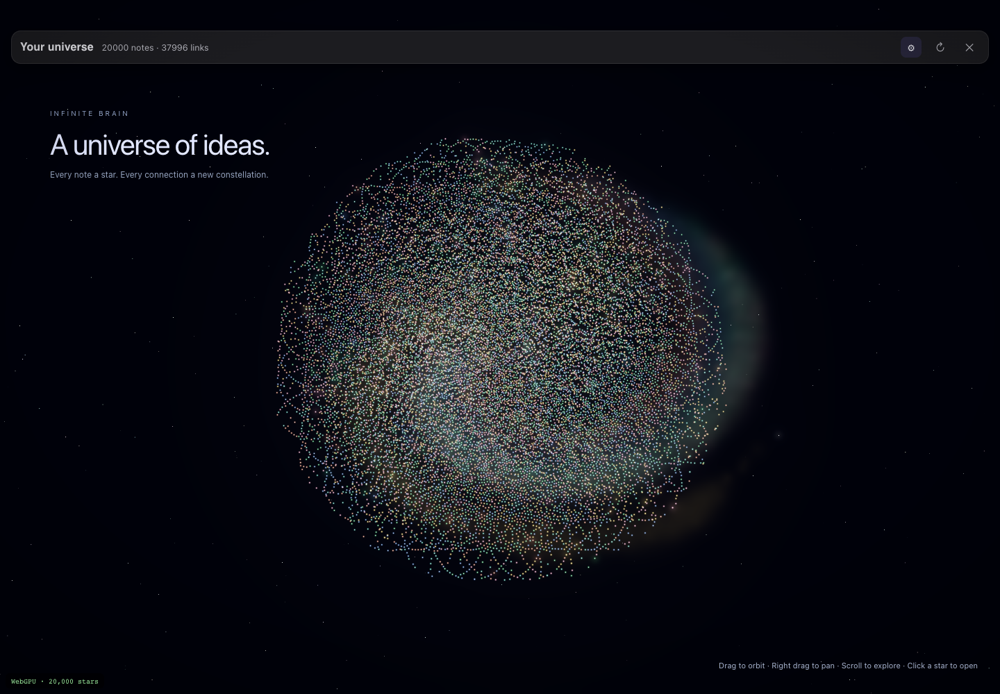
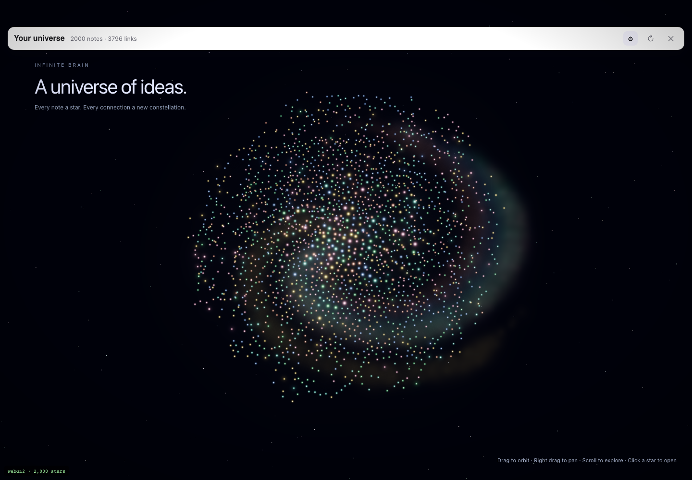

# M5 그래프 은하 뷰 구현 보고서

2026-10-14 · `feat/m5-galaxy` · 구현 커밋 `ac35fec` · 시작 HEAD `ddeb700`.

기존 force 시뮬레이션의 x/y를 유지한 채 노트를 발광하는 별로 바꿨다. 폴더에 따른 깊이·나선 성운, 링크 수와 최근 수정 시각에 따른 별 크기/밝기, 배경 별, TSL 블룸을 적용했다. 카메라는 orbit/pan/zoom을 지원하고, 별 클릭은 650ms 비행 후 기존 `openNoteByPath`로 연결한다. reduced-motion에서는 비행을 생략한다. 검색·최소 링크 필터·설정·호버 라벨과 연결선 강조를 유지했고, 방향키 선택/Enter 열기, 포커스 표시와 상태 알림, 확대 시 최대 12개 라벨을 제공한다. 좁은 창의 설정 패널은 스크롤되도록 수정했다.

`three@0.186.1`, `@types/three@0.186.0`을 고정했다. WebGPU를 먼저 초기화하고 미지원 시 Three.js의 WebGL2 backend를 사용하며, GPU 초기화/실행 실패 시 기존 Canvas2D 경로로 복귀한다. 별/성운은 인스턴싱하고 배경 링크는 최대 18,000개 수준으로 LOD 처리한다. 모든 노트와 선택한 노트의 가시 연결선은 보존한다. worker에서 새 좌표가 올 때만 버퍼를 올리며, 안정화된 화면은 카메라/입력 변경 때만 GPU를 다시 그린다. StrictMode worker 재생성과 필터 변경 시 공유 Sprite geometry 해제 문제도 수정했다. GraphView는 별도 lazy chunk로 유지되고 최종 Safari 대상 빌드에서 982KB, gzip 273KB였다. CDN과 CSP 변경은 없다.

[참고 저장소](https://github.com/dgreenheck/webgpu-galaxy)의 [galaxy.js](https://github.com/dgreenheck/webgpu-galaxy/blob/main/galaxy.js), [main.js](https://github.com/dgreenheck/webgpu-galaxy/blob/main/main.js), [helpers.js](https://github.com/dgreenheck/webgpu-galaxy/blob/main/helpers.js)를 검토했다. GPU billboard, 나선 분포, 가산 혼합, bloom 구성을 참고해 독립 구현했으며 원본 코드/텍스처를 복사하지 않아 MIT 복제 고지나 NOTICE 추가는 필요하지 않았다. WebGPU/WebGL2 전환은 [Three.js 공식 계약](https://threejs.org/docs/pages/WebGPURenderer.html)에 맞췄다.

**화면 증거.** 실제 GraphView와 force worker를 합성 IPC 데이터로 실행했다. 실 vault/서버 연결은 없다. 큰 화면 1440×1000과 작은 화면 720×600을 직접 확인했다.

추가 화면: [200개](docs/galaxy/macos-200-light.png), [2,000개 다크](docs/galaxy/windows-2000-dark.png), [선택/호버 별](docs/galaxy/selected-star.png), [검색](docs/galaxy/search-filter.png), [Windows 좁은 설정](docs/galaxy/windows-narrow-settings.png), [macOS 좁은 설정](docs/galaxy/macos-narrow-settings.png), [2D 복귀](docs/galaxy/fallback-2d.png). 기존 전체 앱 시뮬레이터에서도 [Windows 창 버튼](docs/galaxy/app-windows.png)과 [macOS 상단 여백](docs/galaxy/app-macos.png)을 확인했다.

**성능.** Apple M5 / 24GB, Chrome 155.0.8059.40 headless, 1440×1000, DPR 1. force 안정화 뒤 실제 마우스 drag로 6초 동안 orbit하며 제출된 렌더 프레임을 세었다. 유휴 rAF 횟수를 FPS로 계산하지 않았다. 수치는 합성 데이터와 이 장비의 결과이며 네이티브 Windows 수치가 아니다. 마지막 열은 초기 배치 안정화 및 추가 2초 대기를 포함한다.

| 노트 | backend / 레이아웃 / 테마 | orbit FPS | 프레임 간격 p95 | 첫 프레임 | 안정화 후 측정 준비 |
| ---: | --- | ---: | ---: | ---: | ---: |
| 200 | WebGPU / macos / light | 59.9 | 17.6 ms | 0.61초 | 4.37초 |
| 2,000 | WebGPU / windows / dark | 59.9 | 17.0 ms | 0.98초 | 9.78초 |
| 20,000 | WebGPU / macos / dark | 59.5 | 17.6 ms | 0.47초 | 40.70초 |
| 2,000 | WebGL2 / windows / light | 59.9 | 17.6 ms | 1.08초 | 9.86초 |

2만 개의 첫 프레임은 0.47초, 초기 설정 열기는 193ms였다. 초기 force 계산 동안에도 조작 가능하지만 완전 안정화 대기는 약 40.7초로 길다. 원시 측정은 [performance.json](docs/galaxy/performance.json), UI 결과는 [interactions.json](docs/galaxy/interactions.json)에 보관했다. 최종 4개 성능 하네스 검증의 page/console 오류는 0개다.

**실행 검증.** `app/`에서 먼저 `pnpm install` 완료. 아래 명령은 `app/apps/desktop/` 기준이다.

- `pnpm exec tsc --noEmit` — 통과, 진단 0개.
- `NODE_OPTIONS=--no-experimental-webstorage pnpm exec vitest run src/lib/graph src/__tests__/csp.test.ts` — 6개 파일, **49개 테스트 통과**(새 깊이/최근 수정 순수 함수 테스트 2개 포함).
- `pnpm run build` — Safari 13 대상 프런트엔드 빌드 통과.
- `TAURI_ENV_PLATFORM=windows pnpm exec vite build` — Windows 대상 프런트엔드 빌드 통과. 청크 크기 경고는 남는다.
- `PLAYWRIGHT_MODULE=/Users/iron/.agents/skills/gstack/node_modules/playwright/index.mjs CHROMIUM_EXECUTABLE='/Applications/Google Chrome.app/Contents/MacOS/Google Chrome' node dev/graph-galaxy/verify.mjs` — 4개 데이터/backend 조합의 캡처·orbit 측정·키보드 열기, 0개 필터 결과→복원·검색 검증 통과.
- 같은 환경 변수로 `node dev/graph-galaxy/verify-ui.mjs` — 양 플랫폼 좁은 화면·검색·키보드·reduced-motion, 실제 포인터 호버 연결선/클릭 비행, WebGPU API 부재→WebGL2 자동 대체, GPU context 전부 실패→2D 복귀 검증 통과.
- 전체 앱 시뮬레이터의 Windows/macOS 그래프를 Chromium으로 열어 캡처·육안 확인. `git diff --check` 통과.

재현은 [하네스 README](app/apps/desktop/dev/graph-galaxy/README.md)를 따른다. 개발 서버는 `pnpm exec vite --mode simulator --host 127.0.0.1 --port 1435 --strictPort`, 페이지는 `/dev/graph-galaxy/?count=20000&platform=macos&theme=dark`다. 검증용 1435 서버는 작업 종료 시 정리했다.

**한계와 범위.** Playwright WebKit 바이너리가 설치되지 않아 WebKit/WKWebView 및 네이티브 Windows WebView2·DPI·창 동작·설치 패키지 CSP는 미검증이다. 최근 수정 밝기는 현재 로드된 트리 metadata만 사용하고, 값이 없는 노트는 중립 밝기로 표시한다. 클러스터는 기존 그래프에 제공되는 폴더 기준이며 태그 데이터 계약을 새로 만들지 않았다. 2D 대체는 기존 600노트 제한을 유지한다. Endor의 정확한 three 버전 조회는 자격증명 부재로 실패하여 패키지 위험 판정은 UNKNOWN이며 라이브 보안 검증을 주장하지 않는다. Rust/서버/전체 desktop 테스트는 실행하지 않았고, 3010/3011 서버·Postgres·다른 worktree는 변경하지 않았다. 커밋만 수행했으며 push/배포는 하지 않았다.
