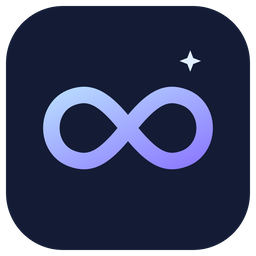
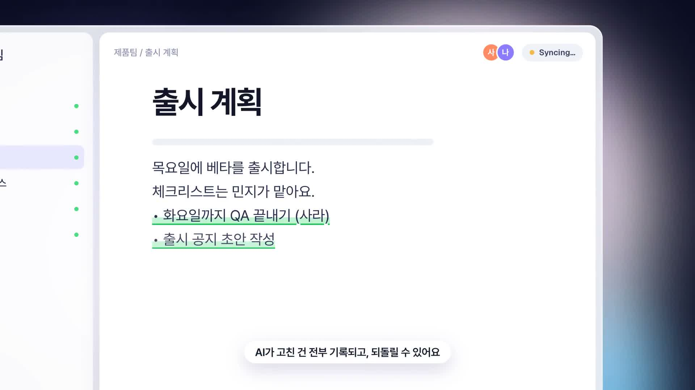
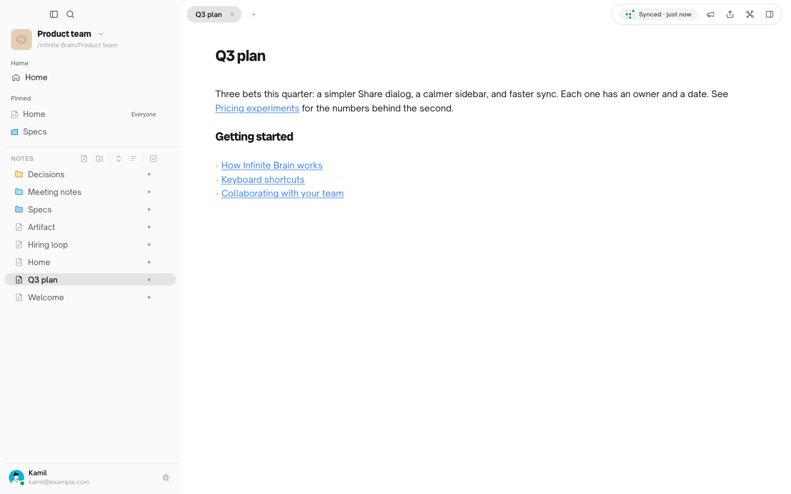
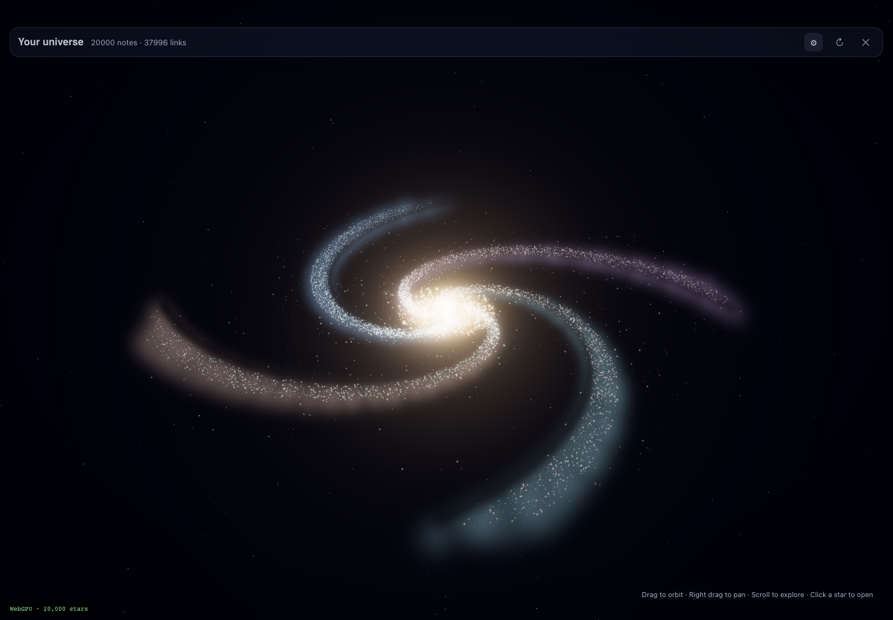
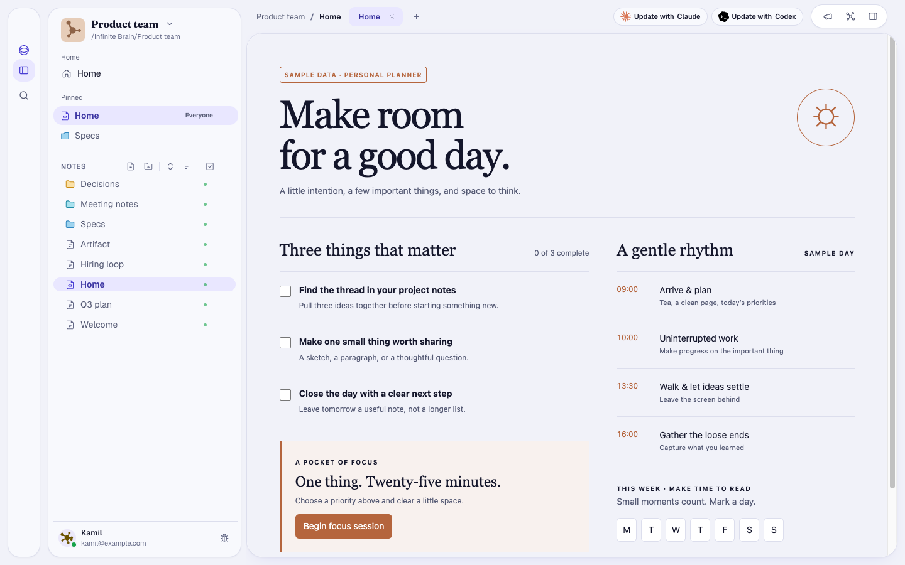
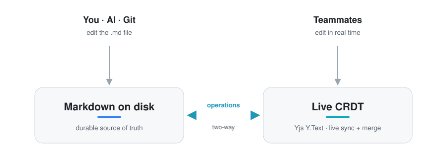

<div align="center">



# Infinite Brain

**Your team's second brain, as plain Markdown files.**<br>
Write on your own computer, edit together in real time, and let your AI read and update the same notes.

[](https://github.com/sangwookp9591/infinite-brain/actions/workflows/ci.yml)
[](LICENSE)


[Download](#-download) · [Getting started](#-getting-started) · [Working as a team](#-working-as-a-team) · [What your team sees](#-what-your-team-sees) · [AI](#-connect-your-ai) · [Self-hosting](#-run-your-own-server) · [Development](#-development) · [Releasing](#-releasing)

<br>

<a href="docs/assets/promo/infinite-brain-promo.mp4"></a>

<sub>▶ <a href="docs/assets/promo/infinite-brain-promo.mp4">Watch the 40-second intro</a></sub>

<br><br>

<picture>
  <source media="(prefers-color-scheme: dark)" srcset="docs/assets/ui/main-dark.png">
  
</picture>

</div>

## Why Infinite Brain

- **Your notes are files.** Every note is a `.md` file in a normal folder. Open it in any editor, back it up any way you like, and keep it if you ever stop using the app.
- **Works offline.** You write locally first. Changes sync when you are back online, and edits from different people merge instead of overwriting each other.
- **Built for teams.** Invite people with a link, choose who can edit or only view each folder, and see who is in a note while you write.
- **Asks once for a star.** After about five days of use a small corner card asks whether you'd like to star the repo on GitHub. It appears once, never blocks a note and never comes back after any answer. The same button lives in **Settings → About**.
- **English and Korean.** Pick the language in **Settings → Appearance** (System, English or 한국어). System follows your computer. Korean covers the sidebar and menus, sign-in, invite and sharing, the sync status and the first-launch tour; the vault settings, health and billing screens are still English.
- **Starts with a short tour.** The first launch plays a four-scene intro before the welcome screen, and it never shows again.
- **AI that you can undo.** Connect Claude or ChatGPT to a vault. Every change an AI makes is recorded, shown as a diff and can be undone.

## 📦 Download

Get the latest version from [**Releases**](https://github.com/sangwookp9591/infinite-brain/releases/latest).

| System | File | Install |
|---|---|---|
| macOS 10.15+ (Apple Silicon and Intel) | `Infinite-Brain_<version>_universal.dmg` | Open the `.dmg` and drag **Infinite Brain** into Applications |
| Windows 10/11 | `Infinite-Brain_<version>_x64-setup.exe` | Run the installer. Windows may show SmartScreen the first time: **More info → Run anyway** |

The app keeps itself up to date: it installs new versions in the background, restarts at a quiet moment and shows what changed. You can also use **Check for updates** in the account menu.

## 🚀 Getting started

1. **Open the app and pick a vault.** A vault is a folder of notes. Create a new one, or open a folder of Markdown files you already have.
2. **Write.** Press **⌘N** (Ctrl+N on Windows) for a new note. Notes save automatically. Link notes with `[[Note name]]`; links and backlinks update when you rename a note.
3. **Find things.** Use search from the icon rail. It matches note titles and content, including Korean and other languages.
4. **See the shape of your notes.** The graph view draws your notes as a galaxy: each star is a note, and lines are links between notes.

Working alone needs no account and no server. Sign in only when you want to work with others.



## 👥 Working as a team

A team shares one **vault** on a server. Everyone keeps a full copy on their own computer, so it stays fast and works offline.

### 1. Create the team vault

Sign in (email and password, or Google if your server has it set up), then create a vault from the vault switcher at the top of the sidebar. If you already have a local vault, you can turn it into a team vault.

### 2. Invite people

Open **Invite people** from the vault menu. You can do it in either of two ways:

- **Invite link.** Enter email addresses and choose each person's role and access. If the server can send email, they get the link by email. If not, copy the link and send it yourself in chat. Opening the link takes them into the app, and they join after they sign in.
- **Join code.** Share the vault's join code. Teammates choose **Join with code** in the app. Codes expire, and an admin can create a new one at any time.

### 3. Decide who can see what

**Vault Settings → Members and access** controls access in plain words:

| Setting | What it means |
|---|---|
| **Everyone in the vault** | Can edit / Can view / No access, for every member by default |
| **New members** | What people who join later get for notes made before they joined |
| **Each person** | Can edit everything / Can view everything / No access / Custom (folder by folder) |

You can also share a single folder or note from **Share…** in the sidebar, or lock a note so it cannot be edited. Roles are **Owner**, **Admin** and **Member**. **Guests** see only the folders shared with them by name, and none of the rest of the vault. Admins can turn external sharing off and revoke all guest access in one step.

### 4. Share a note

From a note's share button:

- **Team link** opens the note for people in the vault who have access.
- **Publish to the web** gives a link anyone can read in a browser. Turn it off and the link stops working.

## 👀 What your team sees

<picture>
  
</picture>

| When… | You see |
|---|---|
| Someone is in the same note | Their avatar at the top of the note, and their cursor and selection moving in the text as they type |
| Someone edits a note you have open | The text changes in place, live. You don't need to reload and nothing gets overwritten |
| Someone edits a note's properties while you are typing | "Changed by someone else while you were typing." under that property |
| Your changes are saved | **Synced · just now** at the top right, and a green dot beside each note in the sidebar |
| You are offline | Your edits are kept on your computer and sent when you reconnect |
| Notes are added, deleted or moved, or your access changes | A line in the **Activity** panel saying what happened, where, and when |
| You want an earlier version | **Version history** on the note. Pick a version and choose **Restore version**, which puts it back for everyone |
| You want someone's attention | **Ping** them from their avatar. They get a notification |
| An AI changed a note | An entry in **Activity → AI changes** with a before/after diff and an Undo button |

Deleted notes go to the system Trash on each computer instead of disappearing, and the app keeps recovery copies when a sync could lose text.

## 🤖 Connect your AI

Open the AI section of **Vault Settings** and follow the wizard to connect Claude or ChatGPT over MCP. Choose what it may do:

- **Read only**: search and read notes
- **Read and write**: also create and edit notes
- **Read, write and delete**

Every AI edit is listed in **Activity → AI changes** with a diff. **Undo** restores the earlier text. If a person has edited the note since then, Undo stops instead of overwriting their work. You can see and disconnect every connection at any time.

AI tools on your own computer (Claude Code, Codex and others) can also edit the Markdown files directly. Their edits show up in the app and sync to your team like any other change.

## 🖥 Run your own server

Your team's notes sync through a server you control. You can run it with Docker Compose on any machine, or on Railway or Coolify.

```sh
cd deploy/compose
cp .env.example .env      # set POSTGRES_PASSWORD, JWT_SECRET and BETTER_AUTH_URL
docker compose up -d
```

Then, in the app, choose **your own server** when you sign in (or go to **Settings → Connection**) and enter its URL. Send teammates `https://<your server>/open/connect` and the app connects to the server on its own.

The full guide, covering HTTPS, email, file storage and backups, is in [`docs/DEPLOY.md`](docs/DEPLOY.md).

## 🧠 How it works

<picture>
  <source media="(prefers-color-scheme: dark)" srcset="docs/assets/bridge-dark.svg">
  
</picture>

- **Markdown on disk is the durable copy.** The desktop app (Rust) writes files atomically and watches for edits made by other programs.
- **A CRDT is the live copy.** Each open note is a Yjs document. Edits from people and AI tools merge without conflicts, and the bridge writes the result back to the file.
- **Stable identity.** Every note has a `doc_id` that survives renames and moves, so links, history and sharing follow the note.
- **The server stores what teams share.** It runs Hono, Hocuspocus and Postgres. It checks permissions on every request and sync connection, so the server enforces access, not the app.

| Part | Path | Stack |
|---|---|---|
| Desktop app | [`app/apps/desktop/`](app/apps/desktop/) | Tauri 2, Rust, React 19, CodeMirror 6, Yjs, SQLite |
| Server | [`app/apps/server/`](app/apps/server/) | Node 22, Hono, Hocuspocus, Better Auth, Postgres, MCP |

More detail is in [`docs/ARCHITECTURE.md`](docs/ARCHITECTURE.md) and [`docs/specs/`](docs/specs/).

## 🛠 Development

Requirements: Node.js 22 or newer, pnpm (via Corepack), Rust, and Docker for Postgres.

```sh
cd app
pnpm install

# Server on http://localhost:3010
cd apps/server
cp .env.example .env        # set a random JWT_SECRET
pnpm run db:up              # Postgres on port 5439
pnpm run migrate
pnpm run dev

# Desktop app, in another terminal from app/
pnpm run dev:desktop
```

| Check | Where | Command |
|---|---|---|
| Server tests (they wipe the configured database, so use a disposable one) | `app/apps/server` | `pnpm test` |
| Desktop tests | `app/apps/desktop` | `pnpm test` (on Node 25: `NODE_OPTIONS=--no-experimental-webstorage`) |
| Rust tests | `app/apps/desktop/src-tauri` | `cargo test` |
| Lint | `app` | `pnpm lint` |

Releasing a version (installers, updates, release notes) is in [Releasing](#-releasing) below.

To build a local macOS app without the updater key:

```sh
cd app/apps/desktop
pnpm tauri build --bundles app --config '{"bundle":{"createUpdaterArtifacts":false}}'
```

Developer notes and the rules that keep data safe are in [`CLAUDE.md`](CLAUDE.md) and [`AGENTS.md`](AGENTS.md). Build status is in [`docs/STATUS.md`](docs/STATUS.md).

## 🚢 Releasing

A release is a version bump, release notes, two installers and one GitHub release. Everything below runs from this repository on one Mac; [`docs/RELEASE_SIGNING.md`](docs/RELEASE_SIGNING.md) has the one-time setup and troubleshooting, and [`docs/RELEASE.md`](docs/RELEASE.md) covers the GitHub Actions path.

**One-time setup** (already done on the release Mac): a Developer ID Application certificate in the keychain, a notarization profile named `axdb-notary` (`xcrun notarytool store-credentials`), the updater key in `~/.infinite-brain/` (`updater.key`, `updater.key.password`, `updater.key.pub`; the public key must match `plugins.updater.pubkey` in `tauri.conf.json`, and the build stops if it does not), `cargo-xwin`, `nsis` and `llvm` for the Windows build, and `gh` logged in.

### 1. Bump the version

Set the same version in all four files (they must agree):

| File | Key |
|---|---|
| `app/apps/desktop/src-tauri/tauri.conf.json` | `"version"` |
| `app/apps/desktop/package.json` | `"version"` |
| `app/apps/desktop/src-tauri/Cargo.toml` | `version` |
| `app/apps/desktop/src-tauri/Cargo.lock` | the `desktop` package's `version` |

The server rejects desktop builds below 0.1.49 on writes, so versions stay above that.

### 2. Write the release notes

Add a `## <version>` section at the top of [`docs/RELEASE_NOTES.md`](docs/RELEASE_NOTES.md). This text is the GitHub release body **and** the What's New card users see after the app updates itself.

- Two to five points, one per change users would notice. No file names or issue numbers.
- Start each point with a short label and a colon, then a sentence: `Korean: The sidebar and menus now speak Korean.` The label becomes the row title in the card; a point without one shows under "New".
- No section, or an empty one, ships silently: the app updates without showing What's New.

### 3. Build and sign

```sh
scripts/build-installers.sh          # macOS and Windows
scripts/build-installers.sh mac      # only the .dmg
scripts/build-installers.sh win      # only the .exe
```

It writes to `dist/<version>/` (git-ignored):

- **macOS:** a universal (Apple Silicon and Intel) `.dmg`, signed with Developer ID and the hardened runtime, then sent to Apple for **notarization** and stapled. Notarization is Apple's automatic check; it usually takes minutes but has taken hours, and the script waits for it. If the wait is cut off (a network drop, say), the submission is not lost: find its id in `dist/<version>/notary.log`, then `xcrun notarytool info <id> --keychain-profile axdb-notary`, and when it says `Accepted` run `xcrun stapler staple` on the `.dmg` (`xcrun stapler validate` and `spctl -a -vv -t open --context context:primary-signature <dmg>` to check) and copy it into `dist/<version>/`.
- **Windows:** an NSIS `*-setup.exe`, cross-compiled on the Mac. It is not code-signed, so Windows shows a SmartScreen warning the first time (**More info → Run anyway**).
- **Updater files:** a `.app.tar.gz` and a `.sig` for each platform, signed with the updater key.

`SKIP_NOTARIZE=1` builds a signed `.dmg` without notarizing; fresh downloads then get a Gatekeeper warning.

Run the macOS and Windows builds **one after the other**, never at the same time (`all` already does): both rebuild the same `app/apps/desktop/dist` folder and the second one fails with `ENOTEMPTY`.

### 4. Publish

```sh
scripts/publish-release.sh           # preview: prints latest.json and the files to upload
scripts/publish-release.sh --yes     # create the GitHub release (goes live at once)
```

The script refuses a `.dmg` that is not notarized and stapled, refuses an installer under 60% of the size of the same kind in the latest release (a build that raced another one can embed half the frontend and still succeed; `ALLOW_SIZE_DROP=1` overrides), refuses to overwrite a release that exists, renames the files without spaces, builds `latest.json` from the `.sig` files and the version's release notes, and runs `gh release create v<version>`.

**What users get.** Installed apps check `releases/latest/download/latest.json` at launch and every 15 minutes, download the update in the background, verify it against the embedded public key, restart at a quiet moment and show What's New. The **Check for updates** button in the account menu does the same on demand. Auto-update does not depend on notarization, only on the updater signature. The portfolio site's install buttons read `releases/latest` and refresh within ten minutes.

### 5. Push, in this order

Publish **first**, push the version bump **after**. Pushing a version bump to `main` runs the [release workflow](.github/workflows/release.yml), which builds and publishes the same version itself, ad-hoc signed without the Apple secrets. It skips a version that already has a release, so with the release already published the push only runs CI.

```sh
git push origin main
```

### Checklist

- [ ] The four version files agree and the release notes section exists
- [ ] `pnpm test` (desktop) and `tsc` pass; server tests run only against a disposable database
- [ ] `xcrun stapler validate` passes on the `.dmg`; the preview shows both platforms
- [ ] After publishing: `curl -sL https://github.com/sangwookp9591/infinite-brain/releases/latest/download/latest.json` shows the new version
- [ ] Then push the commits

### Deploying the server

The desktop app and the server are released separately. The server (`app/apps/server`) ships as a Docker image to Docker Compose, Railway or Coolify; see [`docs/DEPLOY.md`](docs/DEPLOY.md) and [Run your own server](#-run-your-own-server). Raise `MIN_CLIENT_VERSION` only one release after the desktop build that needs it.

## 🤝 Community

[Contributing](CONTRIBUTING.md) · [Security policy](SECURITY.md) · [Code of Conduct](CODE_OF_CONDUCT.md) · [Changelog](CHANGELOG.md) · [Docs index](<docs/Infinite Brain.md>)

## 📄 License

[Apache License 2.0](LICENSE). See [`NOTICE`](NOTICE) for attributions. The design kit's interactions are adapted from [React Bits](https://reactbits.dev) under the MIT + Commons Clause license; see [`app/apps/desktop/src/components/kit/LICENSE-react-bits.md`](app/apps/desktop/src/components/kit/LICENSE-react-bits.md).
