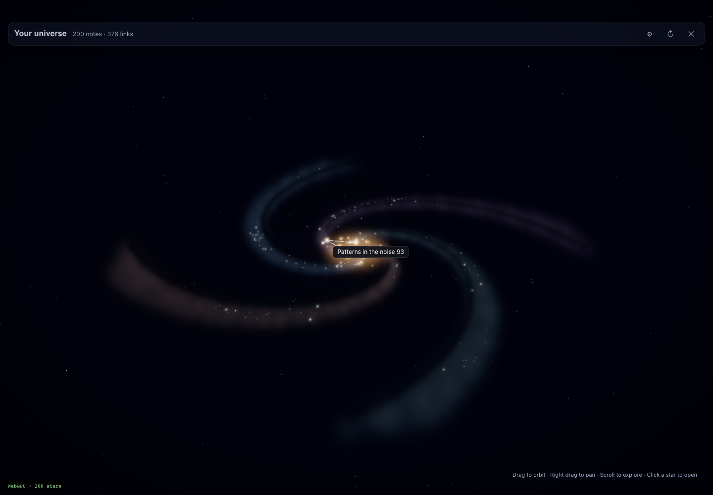
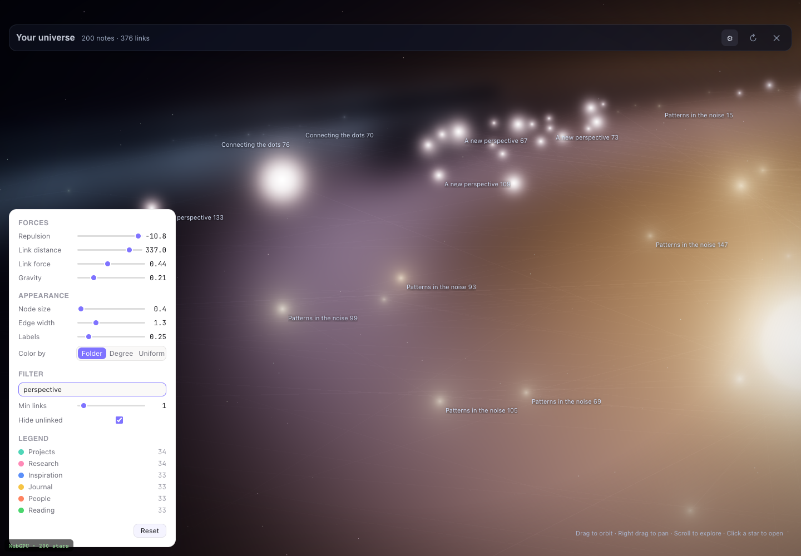
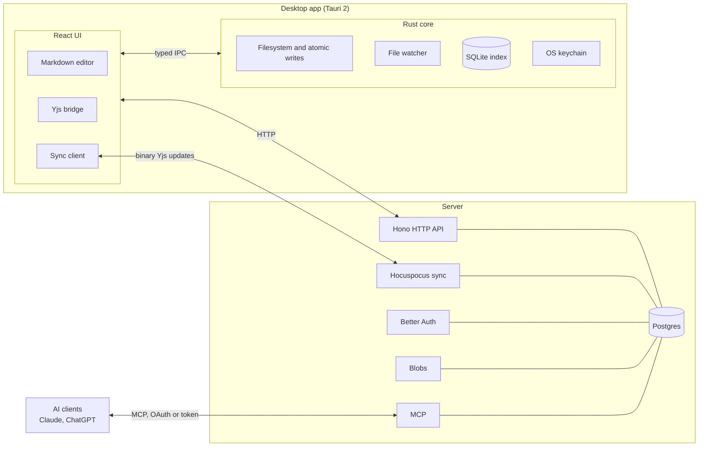

<div align="center">


# Infinite Brain

**A universe of ideas** — a local-first, collaborative Markdown knowledge app.

[](https://github.com/sangwookp9591/infinite-brain/actions/workflows/ci.yml)
[](LICENSE)


[Features](#-features) · [How it works](#-how-it-works) · [Quick start](#-quick-start) · [Architecture](#-architecture) · [Docs](#-docs)

<br>


<sub>The galaxy graph view with 20,000 generated notes and 37,996 links, rendered with WebGPU.</sub>

</div>

<br>

Notes remain plain Markdown files on disk, while a Yjs bridge lets people and connected AI tools edit together in real time.

This independent fork of Baalda 0.1.83 is licensed under Apache-2.0 (the upstream `ee/` directory is not included). See [`NOTICE`](NOTICE) for attribution.

<table>
  <tr>
    <td width="50%"></td>
    <td width="50%"></td>
  </tr>
  <tr>
    <td align="center"><sub>Pick a star to see its note and links.</sub></td>
    <td align="center"><sub>Tune forces, filter by text, and color by folder.</sub></td>
  </tr>
</table>

## ✨ Features

What this fork adds on top of Baalda 0.1.83:

| Area | What it does | Docs |
|---|---|---|
| **AI connection wizard** | Connect your own Claude or ChatGPT to a vault over MCP (OAuth or token). Choose read-only, read+write, or read+write+delete, then review and disconnect connections later. | [`docs/research/W5-mcp-connect.md`](docs/research/W5-mcp-connect.md) |
| **Multilingual search** | Server and MCP search handle Korean and other non-Latin text (Unicode + bigram embedder, zero-score cutoff, `embed_version` re-index). Local search adds trigram and filename matches. | [`docs/reports/IMPL-REPORT-M2.md`](docs/reports/IMPL-REPORT-M2.md) |
| **AI change ledger** | Every AI edit is recorded and can be undone. An undo is refused (409) if a person has edited the note since. | [`docs/AI-CHANGES.md`](docs/AI-CHANGES.md) |
| **Invite links** | Teammates join with a link, no email server needed. | [`docs/onboarding-audit.md`](docs/onboarding-audit.md) |
| **Galaxy graph** | The graph view renders notes as a spiral galaxy (three.js WebGPU, with WebGL2 and 2D fallbacks). | [`docs/galaxy/`](docs/galaxy/) |
| **Rebrand** | App ID `com.infinitebrain.desktop`, URL scheme `infinitebrain://`, new icon and updater key. Rerun `node scripts/rebrand.mjs --dry-run` to check for leftovers. | [`docs/BRAND-ASSETS.md`](docs/BRAND-ASSETS.md) |

Design and research: [`docs/FINAL-report.md`](docs/FINAL-report.md) (Korean) and [`docs/research/`](docs/research/). Build status: [`docs/STATUS.md`](docs/STATUS.md). Docs index: [`docs/Infinite Brain.md`](<docs/Infinite Brain.md>).

## 🧠 How it works

<picture>
  <source media="(prefers-color-scheme: dark)" srcset="docs/assets/bridge-dark.svg">
  
</picture>

- **Stable identity.** Every note has a `doc_id` that is the same across files, SQLite, Yjs, and Postgres. Renames and moves keep the same identity.
- **Markdown on disk is durable truth.** Rust performs atomic writes; the UI never touches the filesystem directly and uses typed IPC.
- **Yjs `Y.Text("content")` is live truth.** The editor edits the CRDT, and the bridge writes it back to disk (egest, about 300 ms) or ingests external file changes (about 150 ms). Echo guards stop the two sides from looping.
- **Binary updates over sync.** Devices and the server exchange binary Yjs updates only. Markdown is never sent over the note sync protocol.

## 🏗 Architecture



| Part | Path | Owns |
|---|---|---|
| Desktop shell | [`app/apps/desktop/src-tauri/`](app/apps/desktop/src-tauri/) | Filesystem access, atomic writes, the filesystem watcher, SQLite index, OS keychain |
| Desktop UI | [`app/apps/desktop/src/`](app/apps/desktop/src/) | React/TypeScript UI, typed Rust IPC, HTTP client, Markdown editor, Yjs bridge, sync client |
| Server | [`app/apps/server/src/`](app/apps/server/src/) | Hono HTTP API, Hocuspocus sync, Better Auth, Postgres, permissions, blobs, MCP |

Inherited architecture reference: [`docs/UPSTREAM-CLAUDE.md`](docs/UPSTREAM-CLAUDE.md). Developer notes and invariants: [`CLAUDE.md`](CLAUDE.md).

## 🚀 Quick start

Requirements: Node.js 22 or newer, pnpm (via Corepack), Rust/Cargo, and Docker (for Postgres).

```sh
cd app
pnpm install

# Server (HTTP :3010, sync WebSocket on the same port at /sync)
cd apps/server
cp .env.example .env        # set a random JWT_SECRET
pnpm run db:up              # Postgres 16 on host port 5439
pnpm run migrate
pnpm run dev
```

Then, from `app/` in another terminal:

```sh
pnpm run dev:desktop
```

The desktop defaults to `http://localhost:3010`. You can choose another server in Settings → Connection.

<details>
<summary><b>Build the macOS app locally</b></summary>

<br>

```sh
cd app/apps/desktop
pnpm tauri build --bundles app --config '{"bundle":{"createUpdaterArtifacts":false}}'
open "src-tauri/target/release/bundle/macos/Infinite Brain.app"
```

Turning off `createUpdaterArtifacts` lets you build without the updater signing key. A local build is ad-hoc signed and not notarized. A release build needs about 4 GB of free disk space.

</details>

Self-hosting guide: [`docs/DEPLOY.md`](docs/DEPLOY.md).

## 🛠 Development

| Where | Test | Lint |
|---|---|---|
| Server, `app/apps/server` | `pnpm test` | n/a |
| Desktop TS, `app/apps/desktop` | `pnpm test` | `pnpm lint` |
| Desktop Rust, `app/apps/desktop/src-tauri` | `cargo test` | n/a |
| Whole workspace, `app` | `pnpm test` (via Turbo) | `pnpm lint` (via Turbo) |

- The server tests wipe the configured database, so point `DATABASE_URL` at a disposable one.
- On Node 25, run the desktop tests with `NODE_OPTIONS=--no-experimental-webstorage`.
- Lint uses an ESLint 9 flat config ([`app/apps/desktop/eslint.config.js`](app/apps/desktop/eslint.config.js)); details are in [`docs/reports/IMPL-REPORT-ESLINT.md`](docs/reports/IMPL-REPORT-ESLINT.md).

## 🗂 Project layout

```text
.
├── app/
│   ├── apps/
│   │   ├── desktop/            Tauri desktop app (React UI)
│   │   │   ├── src/            UI, editor, Yjs bridge, sync client
│   │   │   ├── src-tauri/      Rust: filesystem, watcher, SQLite index, keychain
│   │   │   └── dev/            Galaxy graph preview harness and window simulator
│   │   └── server/             Hono API, Hocuspocus sync, Better Auth, MCP, migrations
│   ├── package.json            pnpm workspace and Turbo tasks
│   └── turbo.json
├── deploy/                     Docker Compose files (compose, coolify)
├── docs/                       Specs, research, reports, galaxy screenshots
├── scripts/                    rebrand.mjs and voice-check
├── CLAUDE.md                   Developer notes and invariants
└── NOTICE · LICENSE            Attribution and license
```

## 📚 Docs

| Doc | What is in it |
|---|---|
| [`docs/Infinite Brain.md`](<docs/Infinite Brain.md>) | Docs index |
| [`docs/STATUS.md`](docs/STATUS.md) | Fork status and build status |
| [`docs/DEPLOY.md`](docs/DEPLOY.md) | Self-hosting guide |
| [`docs/RELEASE.md`](docs/RELEASE.md) | How a desktop release is cut |
| [`docs/AI-CHANGES.md`](docs/AI-CHANGES.md) | AI change ledger contract |
| [`docs/BRAND-ASSETS.md`](docs/BRAND-ASSETS.md) | Rebrand assets and checks |
| [`docs/FINAL-report.md`](docs/FINAL-report.md) | Design and research summary (Korean) |
| [`docs/research/`](docs/research/) | Research reports |
| [`docs/UPSTREAM-CLAUDE.md`](docs/UPSTREAM-CLAUDE.md) | Inherited architecture reference |
| [`CHANGELOG.md`](CHANGELOG.md) | Changelog |

## 🔒 Data compatibility

The `.context/` vault metadata directory and the internal `context` database/code name stay unchanged to preserve existing data formats. Their future names are undecided.

## 🤝 Community

[Contributing](CONTRIBUTING.md) · [Security policy](SECURITY.md) · [Code of Conduct](CODE_OF_CONDUCT.md) · [Trademark policy](TRADEMARK.md)

## 📄 License

Licensed under the [Apache License 2.0](LICENSE). Infinite Brain is an independent fork of Baalda 0.1.83; the upstream `ee/` directory is not included. See [`NOTICE`](NOTICE) for attribution.
