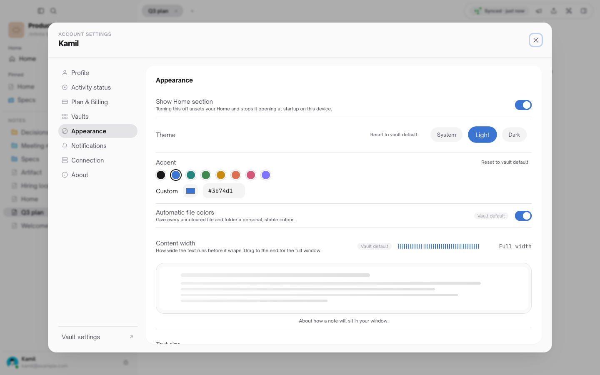
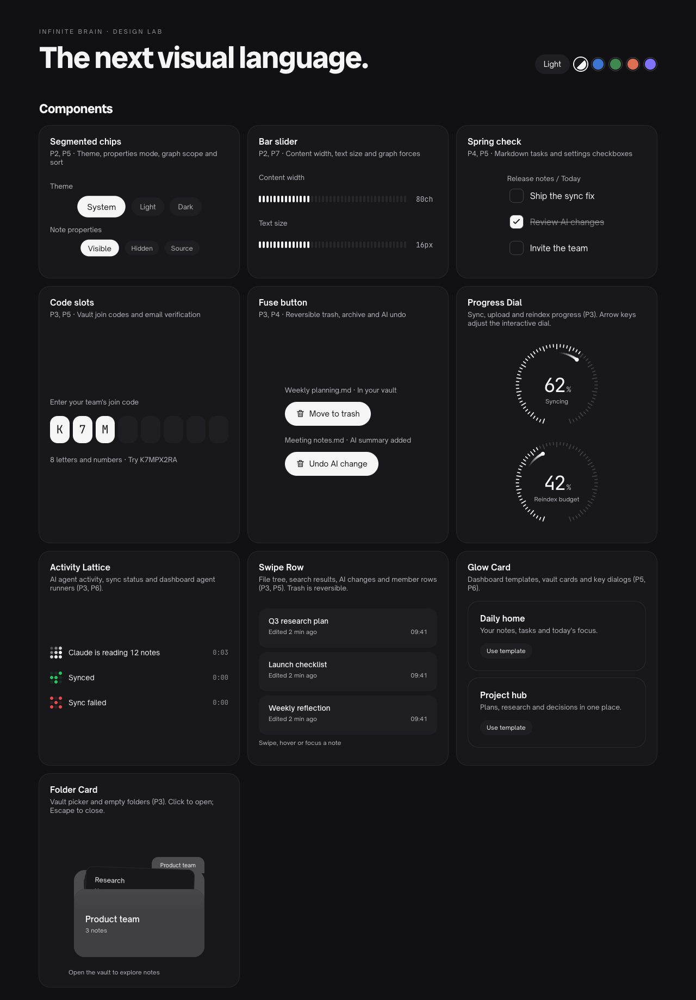
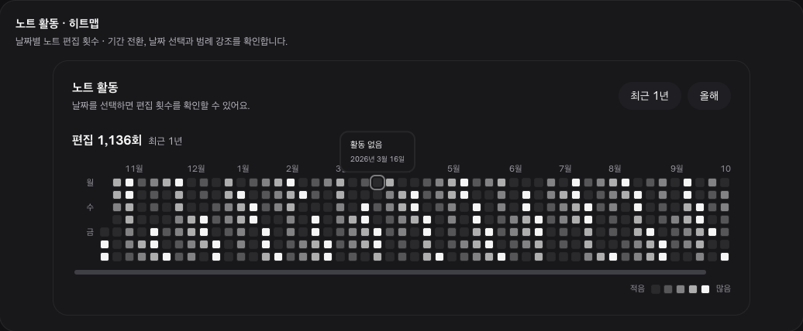
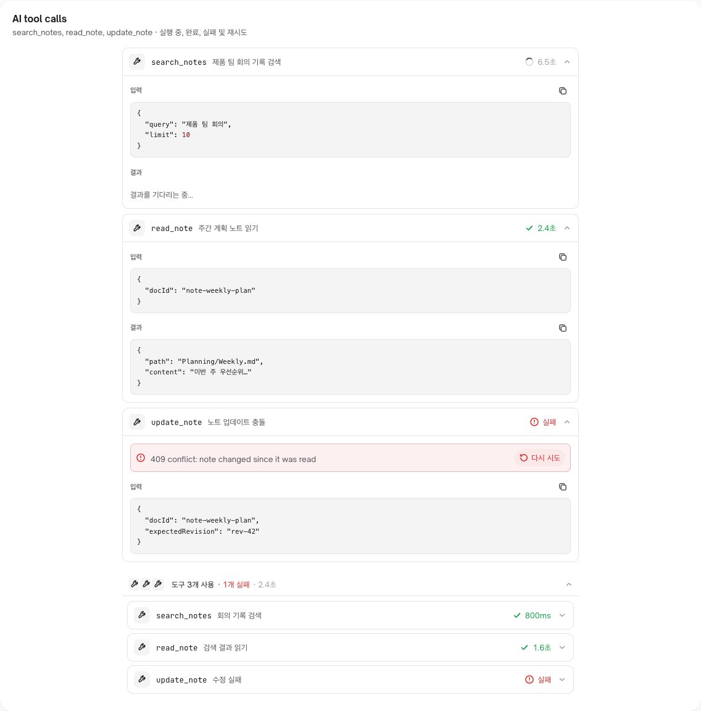
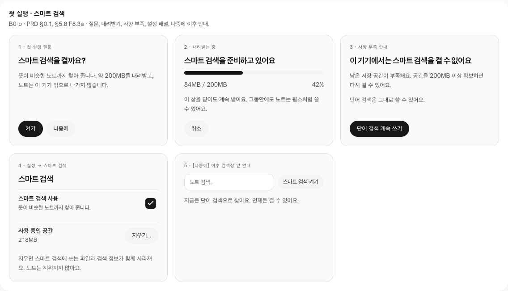
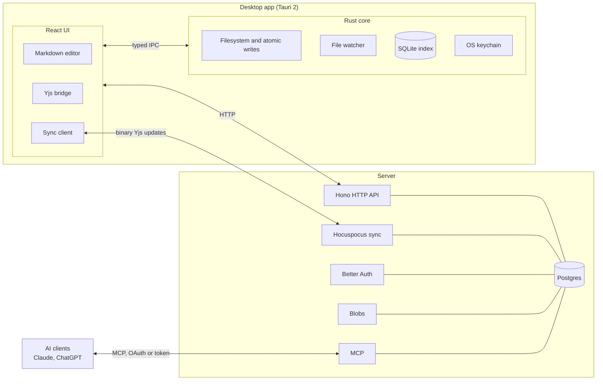

<div align="center">


# Infinite Brain

**A universe of ideas** — a local-first, collaborative Markdown knowledge app,<br>growing into a shared second brain for teams, with a calm ink-on-paper interface you can tint to your own colour.

[](https://github.com/sangwookp9591/infinite-brain/actions/workflows/ci.yml)
[](LICENSE)


[Features](#-features) · [Design](#-design) · [Roadmap](#-roadmap) · [How it works](#-how-it-works) · [Quick start](#-quick-start) · [Architecture](#-architecture) · [Docs](#-docs)

<br>

<picture>
  <source media="(prefers-color-scheme: dark)" srcset="docs/assets/ui/main-dark.png">
  
</picture>

<sub>The main window follows your system theme: zinc surfaces, ink accents, nothing louder than your notes.</sub>

</div>

<br>

Notes remain plain Markdown files on disk, while a Yjs bridge lets people and connected AI tools edit together in real time.

Licensed under Apache-2.0. See [`NOTICE`](NOTICE).


<p align="center"><sub>The galaxy graph view with 20,000 generated notes and 37,996 links, rendered with WebGPU. Only notes glow; opening one dives into it.</sub></p>

<table>
  <tr>
    <td width="50%"></td>
    <td width="50%"></td>
  </tr>
  <tr>
    <td align="center"><sub>Pick a star to see its note and links.</sub></td>
    <td align="center"><sub>Tune forces, filter by text, and color by folder.</sub></td>
  </tr>
</table>

## ✨ Features

| Area | What it does | Docs |
|---|---|---|
| **AI connection wizard** | Connect your own Claude or ChatGPT to a vault over MCP (OAuth or token). Choose read-only, read+write, or read+write+delete, then review and disconnect connections later. | [`docs/reports/IMPL-REPORT-M1.md`](docs/reports/IMPL-REPORT-M1.md) |
| **Multilingual search** | Server and MCP search handle Korean and other non-Latin text (Unicode + bigram embedder, zero-score cutoff, `embed_version` re-index). Local search adds trigram and filename matches. | [`docs/reports/IMPL-REPORT-M2.md`](docs/reports/IMPL-REPORT-M2.md) |
| **AI change ledger** | Every AI edit is recorded and can be undone. An undo is refused (409) if a person has edited the note since. | [`docs/AI-CHANGES.md`](docs/AI-CHANGES.md) |
| **Invite links** | Teammates join with a link, no email server needed. | [`docs/onboarding-audit.md`](docs/onboarding-audit.md) |
| **Galaxy graph** | The graph view renders notes as a spiral galaxy (three.js WebGPU, with WebGL2 and 2D fallbacks). | [`docs/galaxy/`](docs/galaxy/) |
| **New visual language** | Zinc surfaces and an ink accent in light and dark, with spring micro-interactions from a twelve-component design kit across the shell, editor, settings, dialogs and dashboards. | [`docs/superpowers/specs/2026-10-15-ui-redesign-color-design.md`](docs/superpowers/specs/2026-10-15-ui-redesign-color-design.md) |
| **Custom accent** | Pick ink, one of eight presets or any `#rrggbb`, per person or as a vault default. A contrast guard keeps button text at 4.5:1 or better in both themes, and the choice paints from the very first frame. | [`docs/superpowers/plans/2026-10-15-ui-redesign-rollout.md`](docs/superpowers/plans/2026-10-15-ui-redesign-rollout.md) |

Build status: [`docs/STATUS.md`](docs/STATUS.md). Docs index: [`docs/Infinite Brain.md`](<docs/Infinite Brain.md>).

## 🎨 Design

The interface is ink on paper: neutral zinc layers carry the structure, and colour is kept for state (synced, failed, needs attention) and for the accent you choose. Motion uses two springs and switches off under reduced motion.

<table>
  <tr>
    <td width="50%"></td>
    <td width="50%"></td>
  </tr>
  <tr>
    <td align="center"><sub>Appearance settings with a blue accent: theme chips, swatches, bar sliders.</sub></td>
    <td align="center"><sub>The design kit in the design lab, dark theme.</sub></td>
  </tr>
  <tr>
    <td width="50%"></td>
    <td width="50%"></td>
  </tr>
  <tr>
    <td align="center"><sub><code>ActivityHeatmap</code>: a year of note edits, with keyboard navigation and a gliding tooltip.</sub></td>
    <td align="center"><sub><code>ToolCallCard</code>: one AI tool call with its input, result, timing and retry.</sub></td>
  </tr>
</table>

<picture>
  <source media="(prefers-color-scheme: dark)" srcset="docs/assets/ui/b0-first-run-dark.png">
  
</picture>

<p align="center"><sub>Mock of the first-run "smart search" prompt (on-device semantic search): ask once, download about 310 MB (180 MB on low-spec devices), notes never leave the device. Plain words only, no setup.</sub></p>

| Kit component | Where you meet it |
|---|---|
| `SegmentedChips` | Theme, note properties and graph colour mode |
| `BarSlider` | Content width, text size and graph forces |
| `SpringCheck` | Settings checkboxes and the Markdown task look |
| `CodeSlots` | Joining a team with a code |
| `FuseButton` | Undoing an AI change, with a burning-fuse cancel window |
| `ActivityLattice` | Sync status and dashboard agent runs |
| `ProgressDial` | Sync progress when a percentage is known |
| `GlowCard` · `FolderCard` | Dashboard templates and recent vaults on the welcome screen |
| `SwipeRow` | In the kit and the design lab; not wired into app lists yet |
| `ActivityHeatmap` | In the kit and the design lab; planned for vault activity |
| `ToolCallCard` · `ToolCallGroup` | In the kit and the design lab; planned for the AI change log |

Try every component in both themes and with any accent in the design lab: from `app/apps/desktop`, run `pnpm exec vite --mode simulator` and open `/dev/design-lab/`. The kit lives in [`app/apps/desktop/src/components/kit/`](app/apps/desktop/src/components/kit/) and the rules in [`app/apps/desktop/src/styles/DESIGN-BRIEF.md`](app/apps/desktop/src/styles/DESIGN-BRIEF.md).

## 🗺 Roadmap

Infinite Brain is becoming a **second brain the whole team shares**, usable by people who have never touched a terminal: no command line, no extra installs, no jargon on screen. The plan is in the [team second-brain PRD](docs/superpowers/specs/2026-10-15-team-second-brain-prd.md) (Korean).

| Track | Goal | Status |
|---|---|---|
| **A · Hub teams** | Guests, join codes that expire, external-sharing policy, audit log, approval queue, domain auto-join, on the existing server | A0 design [merged](docs/superpowers/specs/2026-10-16-a0-authorization-design.md) and verified. It found three existing authorization gaps; fixing them (A1-0) comes first |
| **B · Smart search** | On-device semantic search with EmbeddingGemma 2 running inside the app (llama.cpp, GGUF), offered with one "turn on?" prompt | First-run mock [merged](docs/reports/B0-FIRST-RUN-MOCK.md). The [llama.cpp spike](docs/reports/B0-LLAMA-SPIKE.md) runs it in-app on Apple Silicon (about 15 ms per paragraph on Metal); B1 starts from a llama.cpp fork |
| **C · Share without a server** | Peer-to-peer vaults over Iroh with end-to-end encryption, working on an offline LAN | [C0 design](docs/superpowers/specs/2026-10-16-c0-p2p-design.md) merged as draft r4; four independent checks so far, one more round of rule fixes before the C1 LAN experiment |
| **D–F** | Storage node, attachments, local MCP, connected vaults, moving a P2P vault to a hub | After A–C |

Both modes will live side by side: run your own server as today (hub), or share a vault with no server at all (P2P).

## 🧠 How it works

<picture>
  <source media="(prefers-color-scheme: dark)" srcset="docs/assets/bridge-dark.svg">
  
</picture>

- **Stable identity.** Every note has a `doc_id` that is the same across files, SQLite, Yjs, and Postgres. Renames and moves keep the same identity.
- **Markdown on disk is durable truth.** Rust performs atomic writes; the UI never touches the filesystem directly and uses typed IPC.
- **Yjs `Y.Text("content")` is live truth.** The editor edits the CRDT, and the bridge writes it back to disk (egest, about 300 ms) or ingests external file changes (about 150 ms). Echo guards stop the two sides from looping.
- **Binary updates over sync.** Devices and the server exchange binary Yjs updates only. Markdown is never sent over the note sync protocol.

## 🏗 Architecture



| Part | Path | Owns |
|---|---|---|
| Desktop shell | [`app/apps/desktop/src-tauri/`](app/apps/desktop/src-tauri/) | Filesystem access, atomic writes, the filesystem watcher, SQLite index, OS keychain |
| Desktop UI | [`app/apps/desktop/src/`](app/apps/desktop/src/) | React/TypeScript UI, typed Rust IPC, HTTP client, Markdown editor, Yjs bridge, sync client |
| Server | [`app/apps/server/src/`](app/apps/server/src/) | Hono HTTP API, Hocuspocus sync, Better Auth, Postgres, permissions, blobs, MCP |

Architecture reference: [`docs/ARCHITECTURE.md`](docs/ARCHITECTURE.md). Developer notes and invariants: [`CLAUDE.md`](CLAUDE.md).

## 🚀 Quick start

Requirements: Node.js 22 or newer, pnpm (via Corepack), Rust/Cargo, and Docker (for Postgres).

```sh
cd app
pnpm install

# Server (HTTP :3010, sync WebSocket on the same port at /sync)
cd apps/server
cp .env.example .env        # set a random JWT_SECRET
pnpm run db:up              # Postgres 16 on host port 5439
pnpm run migrate
pnpm run dev
```

Then, from `app/` in another terminal:

```sh
pnpm run dev:desktop
```

The desktop defaults to `http://localhost:3010`. You can choose another server in Settings → Connection.

<details>
<summary><b>Build the macOS app locally</b></summary>

<br>

```sh
cd app/apps/desktop
pnpm tauri build --bundles app --config '{"bundle":{"createUpdaterArtifacts":false}}'
open "src-tauri/target/release/bundle/macos/Infinite Brain.app"
```

Turning off `createUpdaterArtifacts` lets you build without the updater signing key. A local build is ad-hoc signed and not notarized. A release build needs about 4 GB of free disk space.

</details>

Self-hosting guide: [`docs/DEPLOY.md`](docs/DEPLOY.md).

## 🛠 Development

| Where | Test | Lint |
|---|---|---|
| Server, `app/apps/server` | `pnpm test` | n/a |
| Desktop TS, `app/apps/desktop` | `pnpm test` | `pnpm lint` |
| Desktop Rust, `app/apps/desktop/src-tauri` | `cargo test` | n/a |
| Whole workspace, `app` | `pnpm test` (via Turbo) | `pnpm lint` (via Turbo) |

- The server tests wipe the configured database, so point `DATABASE_URL` at a disposable one.
- On Node 25, run the desktop tests with `NODE_OPTIONS=--no-experimental-webstorage`.
- Lint uses an ESLint 9 flat config ([`app/apps/desktop/eslint.config.js`](app/apps/desktop/eslint.config.js)); details are in [`docs/reports/IMPL-REPORT-ESLINT.md`](docs/reports/IMPL-REPORT-ESLINT.md).

## 🗂 Project layout

```text
.
├── app/
│   ├── apps/
│   │   ├── desktop/            Tauri desktop app (React UI)
│   │   │   ├── src/            UI, editor, Yjs bridge, sync client
│   │   │   ├── src-tauri/      Rust: filesystem, watcher, SQLite index, keychain
│   │   │   ├── src/components/kit/  Design kit (spring micro-interactions)
│   │   │   ├── dev/            Design lab, galaxy lab and window simulator (WebMCP-enabled)
│   │   │   └── spikes/         Throwaway experiments (not part of the app build)
│   │   └── server/             Hono API, Hocuspocus sync, Better Auth, MCP, migrations
│   ├── package.json            pnpm workspace and Turbo tasks
│   └── turbo.json
├── deploy/                     Docker Compose files (compose, coolify)
├── docs/                       Specs, research, reports, galaxy screenshots
├── scripts/                    voice-check
├── CLAUDE.md                   Developer notes and invariants
└── NOTICE · LICENSE            Attribution and license
```

## 📚 Docs

| Doc | What is in it |
|---|---|
| [`docs/Infinite Brain.md`](<docs/Infinite Brain.md>) | Docs index |
| [`docs/STATUS.md`](docs/STATUS.md) | Build status |
| [`docs/NEXT-TASKS.md`](docs/NEXT-TASKS.md) | Next tasks and handoff notes (Korean) |
| [`docs/DEPLOY.md`](docs/DEPLOY.md) | Self-hosting guide |
| [`docs/RELEASE.md`](docs/RELEASE.md) | How a desktop release is cut |
| [`docs/AI-CHANGES.md`](docs/AI-CHANGES.md) | AI change ledger contract |
| [`docs/BRAND-ASSETS.md`](docs/BRAND-ASSETS.md) | Brand assets |
| [`docs/superpowers/specs/2026-10-15-team-second-brain-prd.md`](docs/superpowers/specs/2026-10-15-team-second-brain-prd.md) | Team second-brain PRD: hub and P2P modes, smart search, roadmap (Korean) |
| [`docs/superpowers/specs/2026-10-16-a0-authorization-design.md`](docs/superpowers/specs/2026-10-16-a0-authorization-design.md) | A0 hub authorization design: expected-permission table and test list (Korean) |
| [`docs/superpowers/specs/`](docs/superpowers/specs/) | All specs, including the UI redesign and colour customization spec |
| [`docs/superpowers/plans/`](docs/superpowers/plans/) | Rollout plan for the new visual language |
| [`docs/reports/`](docs/reports/) | Implementation, review and verification reports |
| [`docs/ARCHITECTURE.md`](docs/ARCHITECTURE.md) | Architecture reference |
| [`CHANGELOG.md`](CHANGELOG.md) | Changelog |

## 🔒 Data compatibility

The `.context/` vault metadata directory and the internal `context` database/code name stay unchanged to preserve existing data formats. Their future names are undecided.

## 🤝 Community

[Contributing](CONTRIBUTING.md) · [Security policy](SECURITY.md) · [Code of Conduct](CODE_OF_CONDUCT.md)

## 📄 License

Licensed under the [Apache License 2.0](LICENSE). See [`NOTICE`](NOTICE).

The design kit's interactions are adapted from [React Bits](https://reactbits.dev) by David Haz under the MIT + Commons Clause license, used as part of this application; see [`app/apps/desktop/src/components/kit/LICENSE-react-bits.md`](app/apps/desktop/src/components/kit/LICENSE-react-bits.md).
