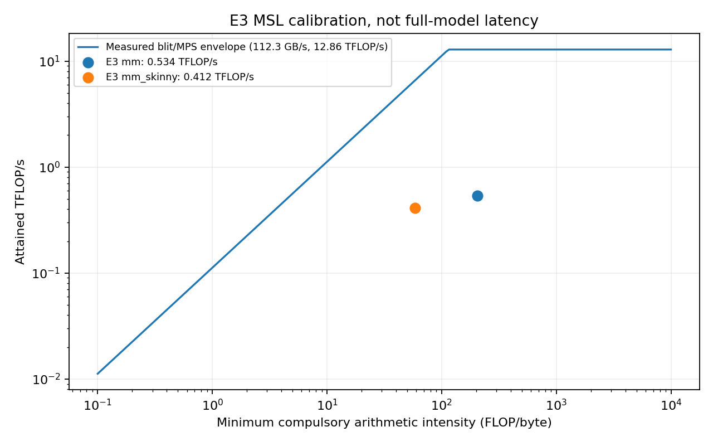

# E3 — Zig + C Metal host 실험

2026-10-20. 연구용 프로토타입이며 앱 코드·모델 다운로드·저장 벡터를 변경하지 않는다.

**인계 상태:** 이번 Dispatch는 구현·진단 결과 인계까지만 완료한다. 최종 두 셀의 5개 독립 프로세스 ×30회 측정과 이 보고서의 최종 통계 통합은 열린 Task `task_29c01c8c2248`로 하네스/조정자에게 이관했다. 실험 전체·독립 검증·채택 판단은 미완료이며, E3 GPU 작업은 실행·대기 중인 것이 없다. 고정 해시와 정확한 후속 명령은 [HANDOFF.md](../../app/apps/desktop/dev/engine-lab/zig-c/HANDOFF.md)에 있다.

## Abstract

EmbeddingGemma 2의 24개 레이어를 Zig가 기록하고 Objective-C의 얇은 Metal API shim을 통해 실행한다. 직접 작성한 MSL 커널과 기존 Mojo의 Apache-2.0 수식을 사용한다. 정확도·성능·배포 비용을 각각 검증하며, 아래의 측정 전 가설과 실제 결과를 구분한다.

## Introduction / Question

질문은 “ggml식 Metal host에 Zig가 C/Objective-C보다 무엇을 더하는가, 이미 Rust를 사용하는 Tauri 앱에도 그 이득이 남는가?”다. GPU 커널 언어는 MSL이므로 Zig 자체가 GPU 수치 연산을 빠르게 한다는 가설은 세우지 않는다.

**측정 전 H1:** 425개 command buffer를 하나로 줄이면 제출 비용이 줄어든다. 그러나 같은 MSL·정밀도·호스트에서 `IB_ZIG_SPLIT=1`과 비교했을 때 SingleStream이 개선되지 않으면 이 구현에서 H1은 지지되지 않는다. **H2:** Zig의 C ABI, 명시적 메모리 관리, ReleaseSafe 검사로 작은 native host를 만들 수 있지만 동일한 기능을 Rust로 구현할 수 있으므로 새 언어를 추가할 제품상 고유 이점은 제한적이다.

## Method

측정 전 분석 모델: `T = T_host + N_cb*t_submit + Σ max(bytes/BW, flops/P)/η + T_gap + T_readback`.
이 합은 겹치지 않는 임계 경로 구간으로 분해할 때만 성립한다. CPU 명령 기록·commit과 GPU 실행의 중첩을 확인하지 않은 채 각각의 합으로 실제 latency를 설명하지 않는다. 자체 calibration을 대입한 값과 roofline은 조건부 비교 envelope이며, workload에 대해 증명된 하한이 아니다.
단일 문단은 82토큰, `N_cb=1`, dispatch 367개(초기 3 + 레이어당 15×24 + 마지막 4)다. 분리 제출 실험은 같은 367개 dispatch를 367개 buffer에 기록한다. `predict.py`가 계산한 GEMM 작업은 22,356,426,752 FLOP, 최소 traffic 397,190,144 bytes, 강도 56.29 FLOP/byte다. 이 traffic은 weight 1회 읽기와 입력·출력 1회이며 cache 재읽기·attention·norm은 제외한다.

32×32 타일의 실제 load/store 명령이 접근하는 바이트 합계는 2,285,816,832 bytes로 계산했다. 입력은 출력 열 타일마다, weight는 입력 행 타일마다 재접근한다. 이 값은 cache hit를 포함하므로 DRAM traffic 실측으로 부르지 않는다. 이 차이가 단순한 모델 weight 크기만으로 latency를 예측할 수 없는 이유다.

역사적 Mojo 23.57ms를 Q8 17.34ms보다 줄이려면 제출 항만 바꿀 때 최소 26.43%를 제거해야 한다. Amdahl 상한은 `1/(1-p)`이고, 424개 제출 제거당 평균 14.69µs 이상의 절약이 필요하다. 이는 두 구현이 커널까지 같다는 조건에서만 가능한 계산이며 E3의 성능 예측값으로 역사적 수치를 재사용하지 않는다. `microbench.py`로 이 MSL 타일과 stream copy를 보정한 후 조건부 roofline 추정과 실제 full forward를 비교한다.
여기서 p는 단순 CPU commit 시간의 비율이 아니라 제거 가능한 직렬 임계 경로 비율이어야 한다. 현재 26.43%는 필요한 민감도 조건이며 실제 trace에서 확인한 p가 아니다.

요인 수준: A=직접 MSL, B=Zig+C/Objective-C, C=FP16 weight·GEMM operand + FP32 accumulation/residual/norm, D=1 buffer/forward 또는 1 buffer/dispatch, E=가변 packed batch(1–100, 최대 16,384토큰). E1 커널은 시작 시 존재하지 않아 복사하지 않았다. E1과 커널이 다르면 호스트 언어의 독립 효과로 비교하지 않는다.

각 sequence의 위치·attention 시작/길이·mean-pool 범위는 별도 metadata다. 같은 GEMM에 묶어도 서로의 토큰을 보지 않는다. `init`은 변환 모델의 magic·전체 크기·413개 tensor의 고정 차원·연속 offset·유한 수치를 검증하고, embed는 입력 포인터와 길이·최대 token 수·vocabulary 범위를 검사한다. FFI pointer의 실제 할당 크기와 handle의 유효 수명은 C ABI 호출자 계약이다. 같은 handle의 병렬 호출·취소·앱의 다운로드 무결성 정책은 이 실험에서 구현하지 않았다.

공통 `inputs.json`, reference token IDs, `verify.py`, `gate.py`를 그대로 사용한다. 최종 반복 측정은 공통 engine-lab harness에 맞춘 `ib_engine_*` C ABI로 수행한다. GPU 작업은 `/private/tmp/ib-gpu-bench.lock`을 직접 획득한 동안만 실행한다. 독립 프로세스 5회, 10회 예열, 30회 SingleStream, Q8 기준선과 교차 실행을 목표로 한다. 미실행 항목은 결과에서 명시한다.

## Results

최종 공통 하네스 반복 측정은 조정자의 순서 배정에 따라 대기 중이다(단일 buffer 주 실험 뒤 split ablation; 각 셀 5개 독립 프로세스 ×30회 기준 유지). 정확도를 통과하지 않은 실행은 성능 결과로 승격하지 않는다. 원래 `verify.py` 예비 검증은 20개 최소 cosine 0.9997069468, 평균 0.9999284187, 혼합 배치 최소 0.9997069468, 정규화 768-d 출력 최대 절대오차 0.00286235, 큰 배치 후 작은 입력 cosine 1.0으로 통과했다. 이 예비 oracle는 기존 세션 파일이므로 성능 채택 비교에는 쓰지 않는다.

이어 실행한 같은 세션 Q8 기준선은 23.1485ms, 최고 batch 32에서 92.1883문단/초였다. 보존한 E3 출력 벡터를 이 fresh Q8의 20개 벡터와 CPU에서 다시 비교해도 같은 최소·평균 cosine과 최대 절대오차가 나왔다. 예비 E3 실행은 37.3391ms / 27.5544문단/초였다. 이 한 쌍은 문제 진단용이며, 5개 프로세스 공통 하네스 비교·신뢰구간·유의성 검정의 대체 결과가 아니다. 근거 파일은 `zig-c/results/original/paired-diagnostic.json`이다.

| 진단용 실행(최종 통계 아님) | 20개 최소 cosine | 82-token 중앙값 ms | 100문단 처리량 /s | 문단당 command buffers / dispatches |
| --- | ---: | ---: | ---: | --- |
| E3 단일 buffer | 0.9997069468 | 37.3391 | 27.5544 (packed100) | 1 / 367 (별도 정적 링크 smoke 실계수) |
| 바로 뒤 fresh llama.cpp Q8 | reference | 23.1485 | 92.1883 (최고 batch32) | 이 실행에서 미측정 |

이 표는 각 1개 프로세스의 원래 게이트 결과다. 예열 10회·독립 프로세스 5회 조건의 최종 IQR/95% CI, 처리량 평균±SD, Server 통계와 split 셀 결과는 후속 Task가 채운다. 이전 llama.cpp trace의 3 command buffers를 이번 진단의 실측 카운터로 옮겨 적지 않았다.

공통 하네스 첫 시도는 oracle와 microbench까지만 끝냈다. 조정자의 측정 순서 정리 요청에 따라 baseline runner가 다른 worker의 GPU lock을 기다리던 경계에서 자기 프로세스 그룹만 종료했다. GPU 측정을 중간에 끊거나 다른 worker의 잠금을 지우지 않았다. `zig-c/results/shared-full/PARTIAL.md`로 표시했으며 이 자료를 최종 성능 통계로 사용하지 않는다.

최종 측정용 수치 구현은 `zig-c/build/frozen/`의 읽기 전용 두 dylib와 기존 FP32 모델의 APFS clone으로 고정했다. 런타임 closure SHA-256은 `results/setup/frozen-runtime.sha256`에 기록했다. 모델 clone은 `edbf9720b35ccbe13dbea1e74da31d7057ea497e9b3b98ed1944462517009f34`이며 원본 변환 모델과 같은 내용이다. 이 복사는 새 모델 다운로드가 아니다.

측정된 자체 MSL calibration: stream copy 57.30GB/s, 1024³ FP16 GEMM 0.534TFLOP/s, 82×512×2048 skinny GEMM 0.412TFLOP/s. 각각 10회 예열 뒤 10회 GPU timestamp 중앙값이며 값 검증을 통과했다. 이는 이 단순 커널의 달성 처리량이고 M5 하드웨어 peak가 아니다. 이미 기록한 분석식에 대입하면 GEMM만 약 41.85ms다. 수치 대입 파일은 예비 검증 뒤, 최종 공통 하네스 측정 전에 저장했으며 full-model 시간으로 계수를 맞추지 않았다.

공통 하네스의 별도 교정에서는 blit 112.27GB/s, MPS FP16 최대 중앙값 12.862TFLOP/s를 관측했다. 최소 필수 traffic 기준 roofline과 비교하면 자체 1024³ 커널은 약 4.15%, skinny 커널은 약 6.26%다. cache 재접근·점유율·threadgroup barrier를 분리한 hardware-counter 측정은 아니므로 저효율의 세부 원인을 확정하지 않는다. 다만 호스트 언어의 효과와 커널 품질을 같은 것으로 취급하면 안 된다는 증거다.

빌드 증거: Zig 0.17.0, Apple M5 24GB, macOS 27.0.1 (26A434), AC 전원 100%. 원본 BF16 SHA-256은 `f315cbbb30dd487e44d501c8902abe88808755e43753a96beed1964f0a48aa4f`, Q8은 `6f1bd4ac6c5df7444f9cca7ca36cafe6cfa34cd6f49fefb1e0b4be8143aed8bc`, fixture는 `1fa81e639754dca9b2df5a9e0e4d967c8559a311866765f676ac894ab3265b5c`다.

## Ablations

동일 dylib의 `IB_ZIG_SPLIT=1`은 제출 단위만 바꾼다. shader·weight·dispatch 수·버퍼 크기는 같다. GPU timestamp와 end-to-end latency를 구분한다.

## Discussion

Zig가 전체 연산 순서, 모델 record 413개 검증, 임시 버퍼의 용량 재사용, 입력 범위 검사, C ABI 수명을 소유한다. Objective-C는 device/queue/pipeline/buffer/encoder 호출만 소유한다. 토큰화나 llama.cpp inference를 구현 경로에서 호출하지 않는다. MSL GEMM은 32×32 타일과 simdgroup 8×8 MMA를 사용한다.

첫 실행 실패는 실제 출력 NaN으로 검출했다. dispatch별 fence와 중간값 검사를 넣어 layer 4 PLE activation에서 처음 NaN이 생기는 것을 확인했다. 큰 GeGLU 입력에서 fast-math `tanh` 인수가 커지는 문제로 좁혔고, 이미 수학적으로 포화되는 ±10으로 인수를 제한했다. 진단 fence 실행은 성능 표에서 제외한다.

빌드 산출물(ReleaseSafe, strip 전)은 dylib 473,328 bytes, Zig+ObjC 정적 archive 2,465,520 bytes, Rust 정적 링크 smoke executable 449,920 bytes다. 이 크기에 모델은 포함하지 않는다. FP32 변환 모델은 1,084,026,976 bytes이며 host는 이를 mmap하고 FP32·FP16 Metal weight buffer를 추가로 만든다. 제품 최적화 메모리 형식은 아니다. `otool -L`에서 Foundation, Metal, CoreFoundation, libobjc, libSystem만 의존하며 별도 Zig runtime dylib는 없다. 생성 코드에 포함되는 Zig 표준 라이브러리·런타임의 MIT 고지는 디렉터리의 `LICENSE-ZIG`에 보존했다. 최종 linker marker는 macOS 14.0이고 ad-hoc 서명 검증은 통과했지만 하위 OS 실행 증거는 아니다.

Cargo 빌드는 자체 `cargo-build.rs`가 archive를 연결하는 별도 smoke crate로 성공했다. 실제 Rust → Zig → ObjC → MSL 호출도 실행해 cosine 0.9999073815와 실계수 1 command buffer / 367 dispatch를 검증했다. Tauri에 넣으려면 기존 Rust build 단계에 고정 Zig compiler 호출과 타깃별 archive 선택을 추가해야 한다. 동적 lib는 앱 bundle 안에 추가해 서명·rpath를 관리해야 하고, 정적 링크는 외부 dylib/rpath 문제를 줄이지만 앱 전체 Developer ID 서명·공증은 그대로 필요하다. 이번 실험은 실제 앱/서명 키/릴리스 절차를 바꾸지 않았다.

`zig cc`로 Apple SDK의 Objective-C shim을 컴파일하는 데 성공했다. Zig의 Windows GNU 타깃 COFF object 생성도 성공했으나, object에는 Metal shim과 POSIX `mmap` 심볼이 미해결 상태다. Windows GPU 구현이 생긴 것이 아니며, Metal·Foundation은 Windows에 없어서 별도 backend와 I/O가 필요하다. Windows DLL 링크도 실제 시도했으며 `mh_*`, `mmap`, `munmap` 등의 미해결 심볼로 실패했다(`results/setup/windows-link.log`). Zig cross compiler의 편의와 엔진의 플랫폼 지원은 구분한다.

판단(추론): C보다 error union·slice·명시적 allocator·ReleaseSafe 검사와 내장 cross compiler를 얻는다. 그러나 unsafe C ABI와 Metal 수명 관리는 남으며, 기존 Rust도 C ABI·slice·Result·정적 archive·Metal binding으로 같은 역할을 할 수 있다. 이 앱에서 Zig만 제공하는 inference 기능이나 검증된 성능 이점은 아직 없다. Homebrew 설치에는 Zig 약 212MB와 LLVM 약 1.6GB, lld 약 5.8MB가 추가됐지만 이들은 개발 도구 크기이며 배포 dylib 크기와 혼동하지 않는다.

## Threats to validity

다른 연구 worker와 GUI 앱이 같은 M5를 사용한다. GPU 잠금은 연구 worker의 측정 중첩을 막지만 다른 앱의 GPU 활동, CPU 빌드, 열·클럭·메모리 압력을 고정하지 못한다. M5/macOS 27 이외의 기기 실행, Windows GPU backend, Developer ID 서명·공증, 실제 Tauri 통합은 별도 증거가 필요하다.

## Conclusion

최종 검증 전에는 채택하지 않는다. 예비 성능은 Q8보다 느리고, Zig가 기존 Rust에 없는 GPU 기능을 제공한다는 증거는 없다. 현재 프로토타입의 결과를 더 나은 MSL 커널이나 모든 Zig 프로그램의 성능으로 일반화하지 않는다. 만약 후속 개선으로 채택하더라도 엔진·정밀도가 바뀌고 Q8 대비 일부 cosine이 0.9999보다 작으므로 앱의 `INDEX_VERSION`과 재색인 정책을 별도로 바꿔야 한다. 이번 작업에서는 저장 벡터를 변경하지 않았다.

## References

- [공통 방법론](ENGINE-LAB-METHODOLOGY.md)
- [Mojo 실측 로그](MOJO-ENGINE-OPTIMIZATION.md)
- [지연 연구](MOJO-LATENCY-RESEARCH.md)
- [Zig 0.17.0 문서](https://ziglang.org/documentation/0.17.0/)
- [Zig build system: static library / cross compilation](https://ziglang.org/learn/build-system/)
- [Zig overview: C interoperability / cross compilation](https://ziglang.org/learn/overview/)
- [Metal command buffers](https://developer.apple.com/library/archive/documentation/3DDrawing/Conceptual/MTLBestPracticesGuide/CommandBuffers.html)
