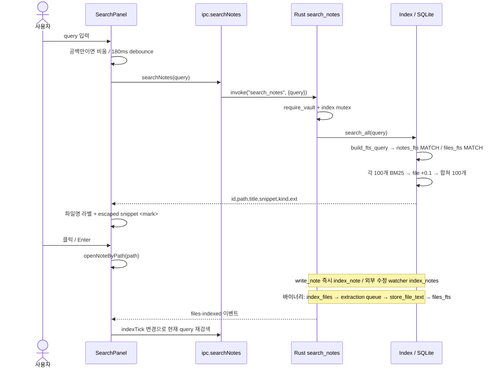
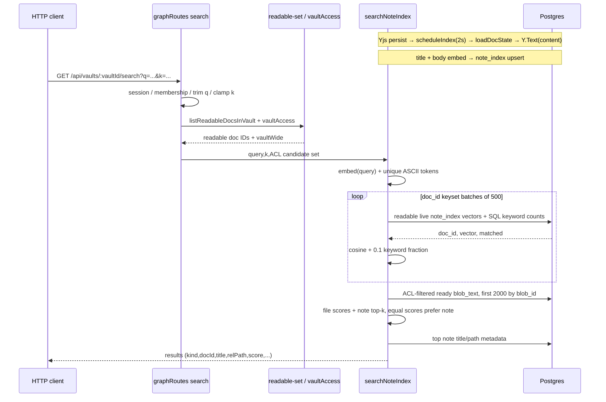
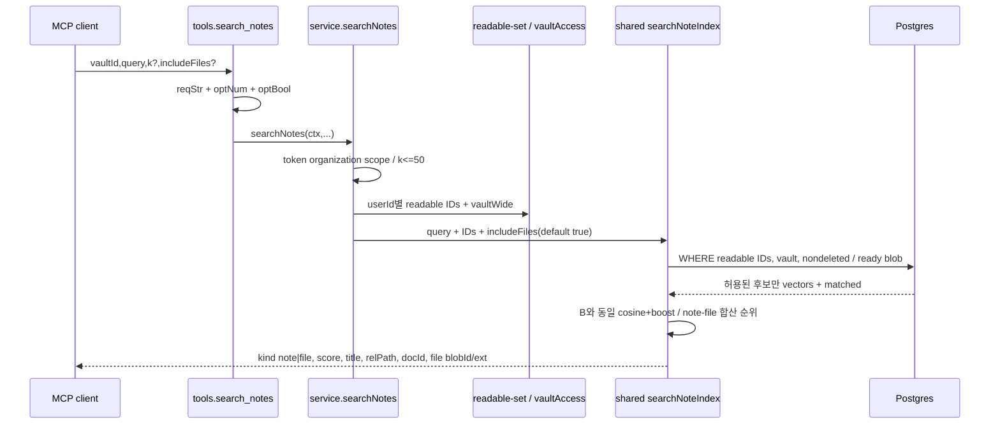

# W3 — Baalda 검색 end-to-end 추적

## 범위와 판정

- [확인] 조사일 2026-10-14, 소스 루트 `/Users/iron/Project/psw/baalda`; 데스크톱 패키지/Rust 버전과 설치본 모두 `0.1.83`이다. (`app/apps/desktop/package.json:4`, `app/apps/desktop/src-tauri/Cargo.toml:3`; 실행 `/usr/libexec/PlistBuddy -c 'Print CFBundleShortVersionString' /Applications/Baalda.app/Contents/Info.plist` → `0.1.83`.) 같은 버전 번호만으로 설치 바이너리와 소스가 동일 커밋이라는 증명은 하지 않았다.
- [확인] 이 디렉터리는 `.git`이 없으며 `git status --short`는 `fatal: not a git repository`였다. 저장소 파일과 실제 볼트는 수정하지 않았고 임시 실측 파일과 이 보고서만 지정 scratchpad에 썼다. (`ls -ld .git app/.git`, 본 작업의 파일 생성 경로.)
- [확인] A는 로컬 FTS5 **접두어 AND 검색**, B와 C는 서버의 **동일 searchNoteIndex 함수**를 쓰는 해시 BoW + ASCII 부분문자열 점수이다. SearchPanel은 서버 검색을 호출하지 않는다. (`desktop/src/components/SearchPanel.tsx:33–51`, `desktop/src/lib/ipc.ts:587–588`, `server/src/http/routes/graph.ts:134–140`, `server/src/mcp/service.ts:1233–1240`; 이하 `desktop/`, `server/`는 각각 `app/apps/desktop/`, `app/apps/server/`.)
- [확인] 가장 큰 한국어 한계: A는 `검색기능`에 `검색`을 찾지만 `기능`을 못 찾는다. B/C 기본 토크나이저는 한글을 버리므로 순수 한글 검색은 모든 후보 점수가 0이 되고 관련 없는 top-k도 반환할 수 있다. (`desktop/src-tauri/src/index.rs:370–373,3154–3170`, `server/src/index/embedder.ts:22–25`, `server/src/index/indexer.ts:371–407,427–459`; 실측 `w3-scratch/fts-output.json`, `w3-scratch/embed-output.json`.)

## A. 데스크톱 로컬 검색

### 시퀀스

[확인] 아래 흐름은 실제 호출/SQL과 인덱싱 코드에서 구성했다. (`SearchPanel.tsx:33–60,70–73,157–179`, `ipc.ts:587–588`, `commands.rs:2060–2066,1742–1752`, `index.rs:1831–1930`, `watcher.rs:451`, `extract_worker.rs:230–308`.)

### 쿼리 가공과 토큰

- [확인] `split_whitespace()` 후 각 조각에서 Rust `is_alphanumeric()` 또는 `_`, `-`만 남긴다. 빈 조각 제거 후 각각 `"term"*`로 만들고 ` AND `로 결합한다. MATCH는 SQL 바인딩 `?1`을 사용한다. (`index.rs:3154–3170,1871–1875,1903–1907`.)
- [확인] 예: `quick brown` → `"quick"* AND "brown"*`; `Quick OR fox` → `"Quick"* AND "OR"* AND "fox"*`이며 OR 연산자가 아니다. 따옴표/`#`/사용자 `*`는 제거된다. `quick-brown`은 보존되지만 unicode61이 하이픈을 분리하므로 인접 phrase의 마지막 토큰 prefix가 된다. (`index.rs:3154–3170`; 실측 `fts-output.json`.)
- [확인] `notes_fts(title,body)`와 `files_fts(name,body)`는 둘 다 `tokenize='unicode61 remove_diacritics 2'`. trigram, porter, 별도 prefix 인덱스 선언은 없다. self-contained FTS이므로 본문을 보유하며 `rowid`는 각각 notes/files의 rowid와 대응한다. (`index.rs:365–373,480–487,1541–1548,1196–1200`.)
- [확인] unicode61은 연속 문자/숫자 등을 토큰으로 만들고 대소문자와 라틴 악센트를 정규화한다. 한국어 형태소 분석은 없다. 한글 어절 내부 **앞부분**은 prefix로 찾고 중간/뒷부분, 초성, 오탈자 보정은 이 코드에 없다. (`index.rs:370–373,3154–3170`; [SQLite unicode61/prefix 공식 문서](https://sqlite.org/fts5.html#unicode61_tokenizer), 실측 §실행 증거.)

### 제목·파일명·태그·파일 본문 포함 범위

| 대상 | 실제 검색 입력 | 판정/근거 |
|---|---|---|
| Markdown 제목 | frontmatter title → 첫 H1 → 파일 stem | [확인] `parse.rs:224–237`, `index.rs:1544–1548` |
| Markdown 파일명/경로 | FTS에 path 컬럼이 없음; stem은 제목 fallback일 때만 | [확인] 제목/H1이 다르면 파일명만으로 찾는 독립 경로가 없다. `index.rs:370–373,1865–1874`, `parse.rs:224–237` |
| Markdown 본문 | frontmatter 제거 후 body, Markdown 자체는 그대로 | [확인] `parse.rs:242–244,294–300`, `index.rs:1546–1548` |
| inline #tag | body에 남은 단어가 일반 FTS로 검색됨 | [확인] `#업무`의 #는 제거되어 업무 prefix 검색이다. `parse.rs:294–300`, `index.rs:3154–3170`; scratch 실측 |
| frontmatter tags | tags/note_tags에 저장하지만 검색 SQL에서 JOIN하지 않음 | [확인] frontmatter에만 있는 tag는 이 검색의 대상이 아니다. `parse.rs:242–255,294–300`, `index.rs:1551–1560,1865–1874` |
| txt/canvas 등 | stem + plain body; HTML은 태그/script/style 제거한 body | [확인] `index.rs:36–46`, `parse.rs:307–336` |
| tree-visible 바이너리 이름 | basename(확장자 포함) + 추출 body | [확인] `index.rs:1038–1042,1180–1199`; 이름만으로 이미지/영상도 검색 가능 |
| root attachments/ | 로컬 file 인덱스에서 제외 | [확인] `vault.rs:111,130`, `index.rs:504–507`; 서버 doc-less attachment 검색과 다름 |
| 큰 노트 | 10MiB 초과 body/links 생략, stem 제목만 인덱싱 | [확인] `index.rs:53–56,1488–1502` |

- [확인] UI에 보이는 라벨은 `result.title`이 아니라 `noteLabel(result.path)`(파일명 stem)이다. 검색에 쓰인 H1/frontmatter 제목과 화면 라벨이 다를 수 있다. (`SearchPanel.tsx:160–165`.)
- [확인] 바이너리는 독립 `files`, `files_fts`, hash별 `file_text` 경로다. worker가 SHA로 재사용/추출하고 `store_file_text`로 FTS body를 갱신한다. Rust 지원은 docx, xlsx/xlsm, pptx, UTF-8 데이터/코드, HTML, zip **entry 이름**이다. PDF는 `Unsupported`, 이미지/오디오/영상은 이름만이다. (`extract.rs:142–160,207–240`, `extract_worker.rs:253–299`, `index.rs:1157–1201`.)
- [확인] 추출 제한은 plain/HTML 2MiB, OOXML/zip 20MiB, 저장 500,000 문자, zip entry 100MiB/전체 200MiB/5,000개/zip 이름 2,000개다. 실패는 status로 남고 파일 이름 검색은 유지된다. (`extract.rs:38–62,207–240`.)
- [확인] `rg -n 'getTextContent|pdfjs|text_status|store_file_text|set_file_text' app/apps/desktop/src app/apps/desktop/src-tauri/src/commands.rs`는 TS PDF 추출 또는 write-back 호출을 찾지 못했다. 서버/MCP 설명에 pdf가 있어도 현재 기본 desktop 경로에서 PDF 본문 검색을 제공한다는 증거는 없다. (`extract.rs:150`, 위 검색 출력, `attachments.ts:2784–2786`.)

### 랭킹과 snippet 안전성

- [확인] 각 테이블은 `bm25(table)` 오름차순 최대 100개; title/body 추가 가중치 인자는 없다. note 점수는 raw BM25, file 점수는 `raw BM25 + 0.1`; 합친 후 오름차순/동점 path 정렬/최종 100개다. (`index.rs:201–204,1865–1873,1897–1917,3185–3200`.)
- [확인] SQLite 공식 BM25는 `-Σ IDF(qᵢ) × [fᵢ × (k₁+1)]/[fᵢ + k₁ × (1-b+b×|D|/avgdl)]`, `k₁=1.2`, `b=0.75`; IDF는 `ln((N-nᵢ+0.5)/(nᵢ+0.5))`를 사용하고 비양수는 작은 양수(1e-6)로 보정한다. 작은 값(더 음수)이 우선이다. ([SQLite bm25 공식 문서](https://sqlite.org/fts5.html#the_bm25_function); `index.rs:1868–1872`.)
- [추정] note/file의 통계 모집단이 서로 다른 FTS 테이블이라 raw BM25를 직접 비교하면 corpus 크기/빈도에 따라 서로 다른 척도가 된다. +0.1은 동점 처리만이 아니라 절대 가산 패널티이며 작은 BM25에서는 영향이 크다. (근거 위 SQL 및 scratch 파일 한 개의 `한국` 점수 `-0.000001 + 0.1 = 0.099999`; 신뢰도 상.)
- [확인] snippet은 column 1(body), 12 토큰, `…` 생략, U+0001/U+0002 강조 sentinel을 쓴다. Rust가 `& < > " '`를 HTML escape한 뒤 sentinel만 `<mark>`/`</mark>`로 치환하고 React가 `dangerouslySetInnerHTML`로 렌더링한다. DOMPurify 호출은 이 경로에 없고 Rust escape가 안전 경계다. (`index.rs:1867,1899,3173–3177,3203–3217`, `SearchPanel.tsx:171–179`.)
- [확인] 파일 추출에서는 control 문자를 제거한다. 노트 parser body는 원문을 보존하므로 “sentinel이 노트에 올 수 없다”는 주석은 모든 파일 입력을 검증했다는 증거가 아니다. 원시 HTML이 escape되므로 sentinel만으로 script가 통과하지는 않지만 임의 `<mark>` 형식 교란 가능성을 구분해야 한다. (`extract.rs:251–257`, `parse.rs:294–300`, `index.rs:1856–1863,3173–3177`.)
- [추정] SearchPanel은 timeout 취소만 하고 이미 시작한 IPC에 request id/취소 guard를 두지 않는다. 응답 순서가 뒤집히면 이전 쿼리 결과가 최신 결과를 덮을 가능성이 있다. (근거 `SearchPanel.tsx:33–51`; 신뢰도 중, 앱 runtime 재현 안 함.)

## B. 서버 HTTP 시맨틱 검색

### 시퀀스

[확인] 아래는 `graph.ts:108–143`, `indexer.ts:69–126,154–171,371–459,488–535`, `hocuspocus.ts:393–405`, `doc-batch.ts:226–228` 기준이다.

- [확인] `q`는 trim 후 비면 400, k 기본 10/최대 100이다. 인증 없으면 401, vault 없으면 404, organization 멤버 아니면 403이다. (`graph.ts:28–40,108–120`.)
- [확인] 현재 desktop `api.ts`에는 `/vaults/:vaultId/search` API 메서드가 없고 `rg -n 'searchVault|semanticSearch|/search\?' app/apps`에서 이 API 호출자는 나오지 않았다. SearchPanel의 사용 경로는 A다. public dashboard template의 `/api/search` demoResponse는 별개 예시다. (`api.ts` 전체 검색, `SearchPanel.tsx:42`; 실행 rg 결과.)

### 인덱싱 시점/데이터와 점수

- [확인] live sync는 `appendUpdate` 성공 후 `scheduleIndex(docId)`를 호출하고 doc별 2,000ms debounce로 재파생한다. detached 일반 쓰기는 `await indexDoc`, bulk defer 경로는 scheduleIndex, MCP live 쓰기는 live transaction, detached는 applyDetached로 같은 경로에 들어간다. (`hocuspocus.ts:393–405`, `indexer.ts:28,154–171`, `doc-batch.ts:226–228`, `mcp/doc-writer.ts:183–209`.)
- [확인] boot `backfillIndex()`가 빠졌거나 `ni.updated_at < n.updated_at`인 살아 있는 노트를 비동기로 재인덱싱한다. 검색 시 즉시 flush는 없다. 삭제는 index purging과 live-row JOIN으로 제외한다. (`server/src/index.ts:369–372`, `indexer.ts:220–258,390–399`.)
- [확인] `loadDocState`의 바이너리 update를 Y.Doc에 적용해 `Y.Text('content')` 원문을 얻고 pgText로 NUL을 정리한다. Markdown에서 plain prose만 추출하는 처리는 없다. title은 notes.title 또는 relPath stem; `${title}\n${content}`를 embed하고 note_index에 **평문 content와 vector**를 저장한다. “opaque Yjs만 DB에 저장”이라는 제품 개요와 달리 이 파생 검색 테이블은 평문 복사본을 보유한다. (`indexer.ts:69–126`.)
- [확인] 기본 embed는 lowercase 후 `/[a-z0-9_]+/g` 토큰. 각 토큰 t의 `FNV1a(t) % 256` bucket에 빈도를 누적하고 L2 정규화한다. `vⱼ = count(bucket=j)/sqrt(Σ count²)`; synonym/문맥/언어모델은 사용하지 않는다. `setEmbedder`는 정의만 찾았고 runtime 호출은 없었다. OPENAI_API_KEY 주석은 자동 provider 전환 코드가 아니다. (`embedder.ts:14,22–69`; `rg -n setEmbedder app/apps`.)
- [확인] `score = cosine(embed(query), storedVector) + 0.1 × matchedDistinctTokens/totalDistinctTokens`. 토큰이 없으면 boost 0, vector 없으면 cosine 0이다. note matched는 SQL `position(tok IN lower(coalesce(title,'') || ' ' || content)) > 0`이다. **ASCII 중간문자열**도 boost로 찾을 수 있다. escape/prefix/FTS MATCH는 없고 배열·문자열 SQL 파라미터를 쓴다. (`indexer.ts:371–407`.)
- [확인] 0점 제거 또는 최소 유사도 cutoff가 없다. note 동점은 doc_id keyset 입력 순서; 파일 동점은 blob_id 입력 순서; note/file 동점은 note 우선이다. 결과는 snippet/강조 HTML을 제공하지 않는다. (`indexer.ts:403–459,510–535`, `NoteSearchHit:275–285`.)
- [추정] pure Korean query에서는 qTokens=[], qVec=0이므로 DB 후보가 있으면 관련성 없는 doc_id순 note가 반환된다. 이는 검색 성공처럼 보이는 실패 형태다. (근거 실제 embed 실행 + 위 score와 무cutoff 정렬; 신뢰도 상, PostgreSQL 전체 runtime 미실행.)
- [추정] 256개 해시 bucket 충돌 때문에 서로 다른 단어가 cosine 유사도로 잘못 관련될 수 있고 오탈자/동의어는 보장되지 않는다. (근거 FNV modulo와 빈도 벡터; 신뢰도 상.)

## C. MCP search_notes

### 시퀀스

[확인] 아래 흐름은 `mcp/tools.ts:91–98,362–388`, `mcp/service.ts:217–227,1205–1240`, `indexer.ts:371–535`에서 구성했다.

- [확인] tools 계약은 query/vaultId required, k 기본 10/최대 50, includeFiles 기본 true이다. service는 finite 양수 k를 trunc 후 50으로 제한한다. `reqStr`은 length===0만 거부하므로 공백-only 문자열은 HTTP와 다르게 통과하며 tokenize 결과가 비게 된다. (`tools.ts:91–98,362–388`, `service.ts:1205–1213`.)
- [확인] MCP 먼저 token organizationId와 vault organization_id를 비교하고, 사용자 readable-set을 구해 공통 검색 함수의 SQL **WHERE 후보 제한**에 넘긴다. unreadable note/file을 먼저 점수화한 뒤 제거하지 않는다. note는 vault + 살아 있는 notes JOIN + ANY(docIds); file은 ready blobs JOIN + doc_id ANY 또는 doc-less + vaultWide 조건이다. (`service.ts:217–227,1231–1240`, `indexer.ts:390–399,510–521`.)
- [확인] readable-set에는 notes와 files가 포함되고 개인/팀 공유, 상속, personal vault posture, sealed에서 authorship 제거, user deny/organization deny 예외와 마지막 deny 차감이 있다. **owner/admin이라는 역할만으로 private vault 모든 문서를 읽는 것은 아니다.** graph/indexer 주석의 “owner/admin see everything”보다 실제 permissions 함수를 기준으로 판단해야 한다. (`permissions/vault-docs.ts:35–48,297–304,441–457,530–548`.)
- [확인] doc-less attachments는 vault-wide reader만 search 후보가 된다. scoped user의 참조 기반 attachment 접근 일부는 검색 후보에서 생략한다. 이는 다운로드와 모든 가능한 참조 접근이 완전히 동일하다는 뜻은 아니다. (`indexer.ts:351–362,517–520`.)
- [확인] 파일 점수는 cosine(blob_text.vector) + query distinct token의 `rel_path + content` substring boost이다. file vector 자체는 **content만** embed한다. filename 컬럼은 label fallback에 쓰지만 keyword SQL에는 독립적으로 포함되지 않는다. (`indexer.ts:506–534`, `http/routes/blobs.ts:1838`.)
- [확인] 파일 후보는 blob_id순 처음 2,000개로 제한되므로 이후 파일은 높은 관련성이어도 검색되지 않는다. note는 제한 없이 500개씩 모든 허용 후보를 훑고 점수 pair를 저장한다. 서버에 ANN/vector index 쿼리는 없다. (`indexer.ts:291–304,377–410,517–521`.)
- [추정] ACL은 요청 시작 readable-set을 점수/metadata fetch에서 재사용하고 metadata 단계에서 ACL을 새로 확인하지 않는다. 요청 중 revocation의 동시성 경계는 별도 검증이 필요하다. (근거 `service.ts:1231–1240`, `indexer.ts:390–399,432–439`; 신뢰도 중, concurrent ACL 실측 안 함.)

### blob_text 생성

- [확인] desktop attachment sync에서 Rust `getFileText`와 `api.uploadBlobText`를 연결한다. 파일 status `ok`, chars>0, SHA 및 업로드 완료 blobId가 있어야 전달한다. 그러므로 이름만/PDF unsupported/추출 실패 파일은 기본 desktop 경로에서 blob_text 행을 만들지 못하고 server filename-only 검색 경로도 없다. (`docSession.ts:7082–7092`, `attachments.ts:2777–2805`, `extract.rs:209–211`, `indexer.ts:510–511`.)
- [확인] PUT `/vaults/:vaultId/blobs/:blobId/text`는 session, 멤버십, vault/ready blob 일치, write/edit 권한, SHA 일치 및 text byte cap을 확인한 뒤 pgText(content)와 embed(content)를 blob_text에 upsert한다. 서버는 직접 PDF/Office bytes를 파싱하지 않는다. (`http/routes/blobs.ts:1733–1842`.)
- [추정] 로컬 추출/업로드/index schedule 지연 또는 실패 때문에 A와 B/C의 검색 결과는 같은 시점에도 다를 수 있다. (근거 `SearchPanel.tsx:53–60`, `indexer.ts:154–171`, `attachments.ts:2786–2790`; 신뢰도 상.)

## 실행 증거: synthetic scratch만 사용

- [확인] 임시 실측 디렉터리는 이 보고서 옆 `w3-scratch/`. `fts_probe.py`는 Python sqlite3로 동일 두 FTS CREATE문/쿼리/snippet을 실행하고 AND/prefix와 실패 케이스를 assert했다. `fts-output.json`에 schema/전체 synthetic fixtures/vocab/모든 query/점수/snippet을 보관했다. 출력은 `ASSERTIONS PASS; sqlite 3.53.0`. OS CLI `sqlite3 --version`은 3.54.0이지만 **본 실측은 Python SQLite 3.53.0**이다. 앱은 rusqlite bundled 사용이며 앱의 실제 SQLite runtime 버전은 확인하지 않았다. (`Cargo.toml:36`, 실측 출력.)
- [확인] synthetic 주 fixture는 한글 body `검색기능과 한국어검색을 테스트합니다`, 영어 body `Quick brown fox database running café`, file `매출보고서.xlsx / 한국어검색 매출액 database`이다. 토큰 vocab에는 `검색기능과`, `한국어검색을`이 각각 한 덩어리로 저장된다. (`fts-output.json`.)

| 입력 | 실제 MATCH | 결과 | 근거 |
|---|---|---|---|
| 검색 | `"검색"*` | 한글 노트 hit | [확인] fts-output.json |
| 검색기능 | `"검색기능"*` | 한글 노트 hit (`검색기능과`) | [확인] 동 파일 |
| 기능 / 어검색 | 각각 prefix | hit 없음 | [확인] 동 파일 |
| 한국 / 한국어검색 | 각각 prefix | 노트와 xlsx hit | [확인] 동 파일 |
| 검색기눙 | prefix | hit 없음 | [확인] 동 파일 |
| 한국 어검색 | 두 prefix AND | hit 없음 | [확인] 동 파일 |
| QUIC | `"QUIC"*` | Quick 두 노트 | [확인] 동 파일 |
| uick / quik | 각각 prefix | hit 없음 | [확인] 동 파일 |
| run / runing | 각각 prefix | 전자는 running hit, 후자는 없음 | [확인] 동 파일 |
| cafe | prefix | café hit | [확인] 동 파일 |
| #업무 | `"업무"*` | body #업무태그 hit | [확인] 동 파일 |
| Quick OR fox | 세 term AND | hit 없음 | [확인] 동 파일 |
| quick-brown | quoted hyphen phrase+prefix | Quick brown hit | [확인] 동 파일 |
| !!! | 빈 MATCH | 반환 [] | [확인] 동 파일 |

- [확인] `한국` 실측 노트 BM25 `-1.2289561195270382`; file raw `-0.000001`, 가산 후 `0.099999`. `quick`이 포함된 악성 HTML fixture snippet의 img 태그/따옴표는 escape되고 match 부분 `<mark>`만 남았다. Python html.escape는 작은따옴표 엔티티 표기가 Rust와 다르지만 `< > & "` escape와 sentinel 치환 순서는 동일하다. (`fts-output.json`, `index.rs:3173–3177,3203–3217`.)
- [확인] Node v25.8.1에서 **소스의 실제** `server/src/index/embedder.ts`를 import해 실행했고 `embed-output.json`에 결과를 보관했다. 순수 `검색`/`한국어검색`은 tokens=[], nonzero=0, 모든 cosine/score=0. `database` → 영어 4-token 문서 0.6, 한글+database 1.1; `data` → cosine 0 + substring boost 0.1; `uick` → quick 포함 문서 boost 0.1; `quik` → 0; `database 한국어검색`는 database 단독과 같은 결과다. boost 부분은 SQL position과 같은 예제 substring 계산을 Node에서 재현한 것이며 **Postgres 실행 증거는 아니다**. (`embed-output.json`, `embedder.ts:22–79`, `indexer.ts:385–405`.)

## 검증 경계와 다음 판단

- [확인] 실행한 것은 synthetic SQLite 스키마/쿼리/assert와 실제 server embedder뿐이다. GUI, native Windows/macOS, Rust unit suite, server DB/API/MCP end-to-end/ACL concurrency는 실행하지 않았다. 실제 볼트와 기존 `.env`/DB는 읽거나 변경하지 않았다. 버전 문자열은 설치본에서 읽었다. (본 작업 실행 명령 목록 및 위 산출물.)
- [추정] 한국어 품질을 우선한다면 B/C는 Unicode 토큰화+저장 vector 재인덱싱 정책부터 검토해야 한다. A의 중간문자열 요구는 trigram/별도 fallback 설계가 필요하며 trigram MATCH는 3자 미만 제약도 평가해야 한다. filename/tag 검색은 현재 별도 컬럼이 없으므로 제품 요구와 일치하는지 먼저 결정해야 한다. (근거 위 코드/실측 및 [SQLite trigram 공식 문서](https://sqlite.org/fts5.html#the_trigram_tokenizer); 신뢰도 상. 개선 구현은 이 읽기 전용 작업에서 수행하지 않음.)
