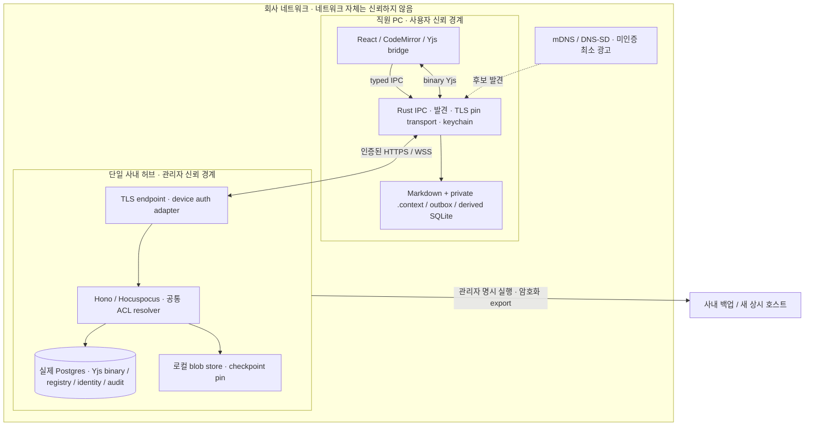
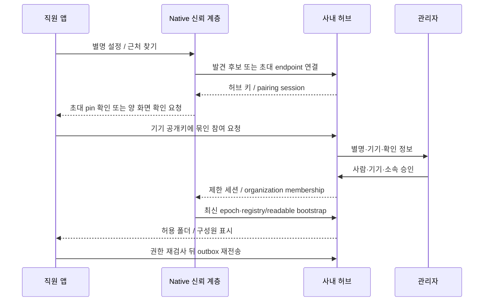

# 07 · 사내 협업 전체 아키텍처

**구현 전 기준안.** [PRD 06](06-office-collaboration-prd.md)을 기술 계약으로 구체화한다. 외부 근거와 대안 비교는 [조사 보고서](../reports/사내%20협업%20동기화%20설계%20조사.md)에 있다. 아래 신규 엔터티·IPC·API는 제안이며 현재 존재하는 인터페이스가 아니다. 기존 활성 계약은 [CLAUDE.md](../../CLAUDE.md)와 [ARCHITECTURE.md](../ARCHITECTURE.md)를 따른다.

## 1. 기준안과 신뢰 경계

**단일 권한 사내 허브 + 직원별 local-first desktop**을 택한다. 본문은 Yjs가 병합하고 회사 가입·기기·ACL·경로·확정 버전의 순서는 허브가 정한다. 처음에는 앱이 관리하는 직원 PC 허브로 시작할 수 있고 동일 신원을 유지해 상시 회사 장비로 이전한다. 자동 리더 선출이나 다중 writable hub는 V1에 없다.

같은 SSID·사설 IP·mDNS 이름은 인증 근거가 아니다. 허브는 plaintext를 처리하므로 E2EE의 비신뢰 relay가 아니다. 직원 PC의 평문 Markdown·색인은 OS 계정/디스크 보호에 의존한다. 같은 망 공격자는 허브 이름을 사칭할 수 있으나 승인된 키와 일치하지 않으면 연결하지 않는다. 침해된 정상 편집자나 허브 관리자의 악성 편집을 CRDT가 막는다고 주장하지 않는다. 권한과 이력·백업으로 피해를 제한한다.

앱의 React는 계속 editor와 bridge를 소유한다. LAN 모드의 연결은 Rust가 키 pin을 검증하고 HTTP/WS를 중계한다. 개인키·장기 기기 자격은 WebView에 전달하지 않는다. 현 TS HTTP/provider를 native transport로 연결하는 adapter와 backpressure·재연결·취소·메시지 순서 검증이 필요하다. 브라우저 전역 TLS 예외, `danger_accept_invalid_certs`, system trust store 변경은 사용하지 않는다. 관리자가 내부 CA 인증서를 제공하는 경로도 pin/회사 정책과 명시적으로 결합한다.

## 2. 기존 코어와 신규 계층의 구분

| 영역 | 확인한 기반 | 추가할 계약 |
|---|---|---|
| 편집·저장 | Y.Text(content), binary updates, Rust atomic write | durable outbox/receipt와 연결 상태 모델 |
| 서버 | Node Hono/Hocuspocus, Better Auth, Postgres | LAN deployment profile, 기기 auth adapter, 제품 runtime 관리 |
| 권한 | user/org grants, deny/private/locks, resolver와 readable set | 정규화 team group principal·epoch, 전 표면 판정 일치 |
| 구조 | stable IDs, tree-ops, cycle/path guards | op idempotency와 optimistic revision 충돌 표시 |
| 버전 | vault checkpoint, forward restore, blob pin 기반 | 폴더 scope·완성 manifest 불변·단계 복원 job |
| 발견·운영 | 서버 URL 설정 기반 | mDNS, 초대, key pin, packaged host, backup/handover fencing |

참조 코드: [shares](../../app/apps/server/src/http/routes/shares.ts), [resolver](../../app/apps/server/src/permissions/resolver.ts), [tree-ops](../../app/apps/server/src/registry/tree-ops.ts), [checkpoints](../../app/apps/server/src/versions/checkpoints.ts), [inbound](../../app/apps/desktop/src/lib/sync/inbound.ts). `groups`라는 공유 API 조회 인자를 팀 그룹으로 재사용하지 않는다.

기존 [04](04-team-collaboration.md)는 과거 organization/vault를 사용자 관점에서 통합해 설명하지만 현재 wire와 DB는 별개다. **회사=organization 한 줄 치환을 하지 않는다.** 제안은 별도 `company_directory_id`를 두고 기존 organization들을 명시적으로 연결하는 extension이다. 단일 organization 파일럿부터 시작하되 회사 디렉터리의 멤버가 자동으로 모든 organization/vault에 가입되지는 않는다. 기존 계정·billing account·organization 관계와 실제 고객 데이터 migration을 확인하기 전 다중 vault 회사 관리를 출시하지 않는다.

## 3. 신원·그룹·저장 모델

다음은 논리 엔터티다. 최종 SQL 명칭과 Better Auth 플러그인 API는 G0에서 고정한다. 서버 ID는 TEXT를 유지한다.

| 제안 엔터티 | 주요 키·필드 | 무결성 계약 |
|---|---|---|
| company_directory / company_org_link | company_id, organization_id | 관리자 명시 연결, 동일 허브 안 회사 경계. org/vault ID 불변 |
| company_person | person_id, company_id, auth_user_id, display_name, avatar_ref | auth_user_id를 기존 authorization identity에 1:1 매핑. 별도 병렬 권한 신원 금지 |
| approved_device | device_id, public_key, person_id, label, status, key_version | 기기 키 생성은 native, 개인키 keychain, 취소 이력 유지 |
| organization_membership | 기존 member + company_person mapping | 회사 직원이어도 해당 organization 소속 없으면 vault 접근 없음 |
| team_group / team_group_member | group_id, company_id, person_id, status | 회사 범위 정규화. 중첩 없음. organization 연결·멤버 확인 후 grant 평가 |
| group_resource_grant | organization_id, resource_type/id, group_id, view/edit | vault 소속 resource 확인. V1 신규 group deny/lock은 금지 |
| host_identity / host_generation | company_id, host_id, generation, key/pin | 단일 writable generation, 이전·복구 이력 |
| pairing_invitation | token_hash, endpoint binding, device binding, expiry, used_at | 단회 사용·회수·횟수 제한, secret 로그 금지 |
| operation_receipt / local_outbox | op_id, actor/device, payload_ref/hash, epoch, status | 재전송 멱등. 로컬 enqueue 먼저 영속화 |
| registry_event / tombstone | revision, item_id, parent_id, path, op_id | stable doc_id, 삭제 명시, 기존 대소문자 경로 규칙 유지. Unicode 정규화·충돌 정책은 G0에서 확정 |
| completed_checkpoint | scope IDs, cutoff, immutable manifest, content/blob refs | preparing→complete, 완성 후 변경 금지, 참조 중 GC 금지 |
| audit_event | actor_id, device_id, name_snapshot, op_id, host_time | mutation과 transaction 일치. 콘텐츠·초대 secret 미기록 |

Better Auth를 삭제하거나 닉네임을 비밀번호로 쓰지 않는다. 새 adapter는 승인된 기기의 challenge 서명을 검증하고 기존 `user.id`/member namespace에 제한 세션을 발급한다. nonce·audience·host generation·만료를 검증하고 replay를 거절한다. 이메일이 필수인 기존 schema와 계정 생성 hook은 migration 대상이다. 직원에게 가짜 이메일을 입력하게 하거나 임의 전역 계정과 자동 병합하지 않는다. 기존 계정 연결은 기존 인증 또는 관리자 확인을 요구한다. 서명/TLS/키 생성·보관은 검토된 라이브러리를 사용하며 자체 암호 primitive/PAKE 프로토콜을 만들지 않는다.

별명·팀·아바타는 표시 데이터다. 인증 후 디렉터리에는 승인된 그룹 소속만 표시한다. 이력은 stable actor와 당시 별명 snapshot을 함께 보여 준다. 아바타는 내부 blob만 사용해 원격 추적 이미지를 자동 로드하지 않는다. 새 PC는 기존 승인 기기나 관리자가 사람 연결을 승인하며 닉네임 일치로 같은 사람으로 합치지 않는다. 키 변경·분실·회전은 새로운 승인 이벤트다.

## 4. 발견·초대·부팅 흐름

발견 서비스는 제안 타입 `_ib-vault._tcp.local.`를 사용한다. 이름·record 길이·Windows/macOS 등록을 spike에서 확인한다. 광고는 프로토콜 버전·임시 instance·port/연결 후보·opt-in 공개 alias 정도로 제한한다. 회사명/팀명도 공개 동의가 없다면 중립 이름을 쓴다. 완전한 member list·문서·폴더·token은 광고하지 않는다. 모든 직원의 PC가 항상 방송하는 방식이 아니다. 승인 후 ‘근처 작업자’는 authenticated hub presence/directory를 통해 제공하고 물리적 거리를 보증하지 않는다.

초대 파일/링크는 hub/company identity, endpoint 또는 내부 DNS, 공개키 pin, 프로토콜, 만료 단회 secret을 담는다. 로그와 진단에서 secret을 가린다. 숫자 코드는 발견된 허브에서 검증된 pairing 절차를 보조할 수 있지만 주소를 대신하지 않는다. 최초 discovery만으로 얻은 pin을 승인 없이 영속 신뢰하지 않는다. 회사 관리자에게 직접 전달받은 초대 또는 양 화면 확인이 필요하다. 실패 시 무제한 재시도나 자동 public relay를 사용하지 않는다.

기존 접속은 기억한 회사 ID·pin·generation으로 재연결하고 IP 변경은 mDNS/내부 DNS로 재해석한다. 재연결 순서는 인증→membership/permission epoch→완전한 readable listing 및 tombstones→본문 pull→현재 권한에 맞는 outbox 전송이다. 기존 **pull-before-seed**, empty-file/orphan, 불완전 listing·bulk deletion 방어를 유지한다. ‘목록에 없음’은 삭제와 회수 둘 다로 추정하지 않는다.

## 5. 하나의 resolver에 그룹 권한을 합친다

기존 resolver를 단순한 highest-wins로 다시 쓰지 않는다. V1 신규 그룹 행은 `view|edit`만 허용하고 user/org deny·lock의 의미는 바꾸지 않는다. 회사 그룹 membership은 해당 organization 가입과 활성 기기 조건을 만족한 뒤 판정 입력으로 들어간다. 판정표와 기존 regression suite의 변경 검토가 migration gate다.

| 순서·조건 | 기존 계약 유지와 그룹 확장 제안 |
|---|---|
| 회사/기기/organization membership 없음 | none. group만으로 가입 우회 금지 |
| 사용자별 item/ancestor deny | none, owner/admin 포함. 그룹 grant로 우회 불가 |
| 개인 vault 수준·join snapshot·vault posture | 기존 baseline/creator/admin 분기 그대로. 그룹 grant는 개인 item grant로 위장하지 않음 |
| org item private/deny 또는 개인 vault denied | 기존 개인 명시 item 예외만 유지. 신규 그룹 grant는 org grant처럼 제외 |
| 정상 grant 합산 | 기존 user/org 결과에 그룹 view/edit를 추가. 개인 vault view cap에 대한 그룹은 org item grant와 같은 규칙 적용 |
| lock/readonly/billing cap | 기존 최종 cap 그대로. 그룹 edit도 우회 금지 |
| owner/admin | 기존 예외가 적용되는 경우만 shortcut. 관리 역할만으로 내용 열람을 새로 보장하지 않음 |

그룹 추가·삭제, grant 변경, 경계 이동은 transaction에서 permission epoch를 증가시키고 commit 후 revocation/presence invalidation을 broadcast한다. 열린 socket을 닫고 후속 write·blob read·검색·MCP 요청은 현 epoch로 재검사한다. 캐시 TTL을 회수 보장으로 쓰지 않는다. 오래된 토큰만으로 편집을 계속 허용하지 않는다. resolver, readable listing, HTTP, sync, blobs, MCP, search/index snippet, backlink/graph metadata와 presence가 같은 범위여야 한다.

구독은 `(device, vault, folder root IDs)`로 따로 둔다. 권한 있는 전체 목록에서 로컬 보관 범위를 고르며 구독은 ACL과 교집합으로 계산한다. 구독 해제는 퇴사·권한 회수가 아니다. 폴더 move는 source/target 쓰기 권한·cycle·cross-vault·경로 충돌과 자손의 전후 readable set을 재검사하고 영향 미리보기를 제공한다. 다른 vault 이동은 V1 구조 op에서 거절하고 별도 복사/가져오기 흐름으로 다룬다.

## 6. 데이터 경로·영속 ACK·충돌 계약

본문은 현 Yjs binary update 경로를 유지한다. Markdown durable truth, `Y.Text("content")` live truth, `.context/` 비공개, 두 echo guard, ingest 약 150ms/egest 약 300ms, Rust atomic I/O는 바꾸지 않는다. native transport는 받은 binary를 동일 bridge에 전달하며 파일을 직접 덮어쓰지 않는다. 새 형식 지원 시 Rust/TS/sync extension 목록을 함께 맞춘다.

편집은 로컬 CRDT persistence와 outbox에 먼저 영속화한다. 로컬 상태는 `local_saved → queued → in_flight → hub_durable`로 구분한다. ‘팀에 반영됨’은 허브의 update·operation receipt·감사 commit을 확인한 ACK 뒤에만 표시한다. Hocuspocus sync 완료/소켓 send는 durable ACK가 아니다. 기존 persistence hook과 결합할 신규 receipt 경로가 필요하다. ACK 유실은 같은 op_id 재전송으로 동일 결과를 돌려주며 동일 op_id의 다른 hash는 거절한다. 상대 PC 디스크 저장 여부는 별도 선택 ACK로만 표시한다.

구조 op는 op_id·base registry revision·현재 permission epoch를 받아 허브 transaction에서 permission→revision→tree guards→mutation/receipt/audit를 처리한다. vault 또는 영향 subtree lock의 순서를 고정해 deadlock을 피한다. stale base는 최신 구조와 충돌 이유를 돌려주고 사용자 선택/재기반을 요구한다. 본문 Yjs 멱등만으로 rename/move의 멱등을 대신하지 않는다. 오프라인 구조 변경은 provisional 상태로 보존하고 재접속 후 허브 확정 경로에 맞춰 안전하게 reconcile한다.

binary는 불변 content-addressed blob와 item revision을 둔다. 업로드 완결·digest 검증 뒤 `expected revision + base digest` 조건부 pointer 교체를 한다. 경쟁하면 승자의 current와 패자의 conflict artifact를 모두 보존하고 선택 UI를 제공한다. 편집 중 표시는 advisory이며 분할 상황의 독점 잠금이 아니다. `.context/`, Office 임시 잠금 파일·OS 메타데이터는 공유에서 제외한다.

삭제는 stable item ID·삭제 revision·actor를 가진 tombstone으로만 반영한다. 휴지통 기간과 tombstone 기간은 별개다. tombstone 보관 창을 넘긴 기기는 오래된 outbox로 재등록하지 않고 full bootstrap 후 복구 사본을 비교한다. 그룹/기기 회수 뒤 미전송 변경은 로컬 private recovery에 보존하고 현재 원본에 자동 전송하지 않는다. 이미 받은 plaintext·외부 사본·캡처는 회수 불가능하다.

## 7. 확정 버전과 단계적 복원

‘현재 공동 작업본’과 ‘확정 버전’을 구분한다. checkpoint request는 허브가 durable하게 받은 범위에서 cutoff를 정한다. 아직 offline인 기기의 편집까지 포함한다고 표시하지 않는다. registry revision만으로 여러 Y.Doc의 동일 시점을 보장하지 못하므로 **hub commit sequence와 문서별 durable revision/state reference를 묶는 capture barrier**를 구현해야 한다. capture는 mutable live head를 나중에 읽지 않고 cutoff에 고정된 참조를 사용한다.

manifest에는 checkpoint ID, vault, scope root IDs, actor, label, cutoff, stable item/parent IDs와 경로, Yjs snapshot reference/digest, blob reference/revision, 포함·누락 목록을 둔다. preparing에서 모든 참조와 ACL을 검증한 뒤 complete로 원자 전환한다. complete manifest는 top-up하지 않는다. 기존 checkpoint의 후속 top-up을 그대로 재사용해 불변이라고 부르지 않는다. 실패한 capture는 incomplete로 표시하고 complete처럼 복원하지 않는다. pin은 완성 및 진행 중 작업을 고려해 GC와 연동한다.

복원은 compare→현재 권한/구조 검사→사전 버전→restore job→registry/본문/blob 단계 적용→검증 순서다. 과거 Y.Doc binary를 live doc에 덮어쓰지 않고 현 Yjs에 forward edit를 적용한다. 광범위 복원은 scope write barrier로 편집 접속을 잠시 막고 job/op별 receipt로 재시도한다. 이미 offline인 기기의 후발 업데이트는 barrier 해제 후 합쳐질 수 있으므로 별도 충돌·후발 변경으로 표시한다. 다중 문서 복원을 하나의 ACID transaction이라고 안내하지 않는다. 중단 상태·적용 완료 항목·실패 항목을 표시하고 재개 가능하게 한다.

버전 열람·diff·복원·blob download도 현재 접근 권한을 재검사한다. 과거에 읽을 수 있었다는 이유로 지금 회수된 파일을 checkpoint에서 열람할 수 없다. diff/manifest의 경로·개수·이전 폴더명·누락 표기도 현재 접근 범위로 필터링하여 회수된 자료의 메타데이터를 노출하지 않는다. 승인 전 초안/배포는 별도 branch/publication 저장 모델이 필요한 후속 기능이며 live CRDT update를 부분 필터링하는 방식으로 구현하지 않는다.

## 8. 제안 IPC·API 계약

아래 이름은 설계용이며 기존 함수를 의미하지 않는다. native bridge capability와 요청 크기·속도·timeout을 제한하고 CSP를 유지한다.

| 제안 인터페이스 | 입력 / 출력 | 경계·필수 검증 |
|---|---|---|
| IPC `lan_discovery_start/stop` | 승인 NIC/opt-in → 정리된 candidate events | native mDNS. 미인증 후보는 신뢰 상태 별도 |
| IPC `lan_pair/accept_invite` | invite/candidate → pending/approved/rejected | pin·expiry·device binding. private key 반환 금지 |
| IPC `office_host_start/stop/status` | host profile → runtime phase/error | loopback PG·명시 LAN bind, 포트/권한/단일 instance |
| IPC native HTTP/WS adapter | 등록된 host ID·method/route·binary → 응답/events | 임의 URL proxy 금지, pin·generation·backpressure |
| API pairing/session | challenge·서명·승인 → 제한 세션 | replay/남용·nonce·audience·generation 검증 |
| API company/groups/assignments | ID·membership/grant op → epoch | 관리자 범위, org/vault 소속, 공통 resolver |
| API bootstrap/subscription | cursor·epoch·root IDs → complete flag·목록 | 읽기 권한·페이지 재검사, 누락과 삭제 구별 |
| API registry operations | op ID·base revision·payload → receipt/conflict | transaction·tree guards·audit |
| WS Yjs + durable receipt | binary update/op ID → 저장 receipt | live protocol 유지, 저장 commit 후 ACK |
| API binary conditional replace | expected revision/digest → current/conflict | blob 완결·ACL·양쪽 사본 보존 |
| API checkpoints/restore-jobs | scope·cutoff/target → status·manifest | 불변 complete·현재 ACL·barrier·재개 |
| IPC backup/handover | 암호화 export 위치·new host → 진행/검증 | OS 파일 I/O, secret 숨김, generation/fencing |

## 9. 설치·장애·상시 호스트와 재해복구

호스트 설치물은 compiled server·고정 Node runtime·native dependencies·실제 Postgres binary와 필요한 extension을 OS별로 동봉/관리한다. 사용자는 Docker·pnpm·개발 명령을 실행하지 않는다. PG는 loopback 전용이고 외부에는 TLS app endpoint만 노출한다. host 데이터는 제품 전용 app data 영역에 두고 개발 `.env`를 읽거나 덮어쓰지 않는다. keychain에는 host/device secret, 데이터 디렉터리에는 최소 권한을 적용한다. 시작은 `stopped→checking→db recovery/migrate→server ready→advertising`; 중지는 광고 중지→신규 작업 차단→durable drain→server/PG 정상 종료로 처리한다.

앱 닫기·백그라운드 공유·공유 종료는 구별한다. 절전/네트워크 변경/프로세스 종료는 offline 상태로 반영하고 직원 outbox를 보존한다. OS service 자동 설치는 관리자 정책·권한에 따른 별도 배포다. 상시 호스트의 headless package/지원 OS는 검증 후 확정하며 일반 직원은 그 운영을 맡지 않는다. 포트 충돌·로컬 네트워크 권한·중앙 방화벽 거절은 구체적 단계 상태와 관리자 진단을 제공한다.

**출시 gate:** Windows x64, macOS arm64/x64에서 native Argon2·PG 시작/회복·migration·동시 쓰기/회수·signed installer·제한 계정·업그레이드 rollback을 실제 검증한다. PG major upgrade는 앱 patch와 분리하고 사전 백업·migration 검사·실패 복구를 둔다. PGlite/SQLite 교체는 현 pg pool/session advisory lock 의미론·전체 migration·동시성·crash·복원을 통과해야 하는 별도 ADR이며 현재 기준안이 아니다.

백업은 DB consistent snapshot/dump와 Yjs·registry·identity/membership·ACL·audit, 정확히 참조한 blob, host config/schema와 암호화 recovery material을 묶는다. capture barrier와 pin으로 dump 도중 새 blob/삭제가 섞이지 않게 하고 manifest digest를 검증한다. 개인 Markdown 폴더만 복사하면 회사 신원·권한·binary 이력을 복원할 수 없다. 외장/사내 백업은 별도 위치에 암호화 저장하고 실제 restore drill로 유효성을 확인한다. 개인 PC 동기화 사본은 백업으로 세지 않는다.

정상 이전은 관리자 시작→새 가입/권한/구조 및 본문 확정 쓰기 일시 동결→최종 durable cutoff/export→새 host import·digest 검사→구 host 영구 fence→새 generation 활성화→클라이언트가 회사 identity·서명된 전환·pin을 확인→outbox 재전송 순서다. device/person/doc/group/vault IDs는 유지한다. 키 이전은 암호화 전용 절차이며 초대 파일에 private key를 넣지 않는다.

새 host는 단순히 같은 IP/회사 이름을 갖는다는 이유로 승인하지 않는다. 이전 generation의 새 연결·쓰기·세션 갱신은 거절한다. 완전한 partition에서 구 호스트의 계속 쓰기까지 막으려면 단일성 증거가 필요하므로 **V1 정상 이전은 구 host 정지/fence 확인이 필수**다. 구 host가 유실된 재해복구는 관리자 복구 자격으로 회사 generation을 전환하고 이전 endpoint/key를 client trust에서 회수한다. 구 host를 다시 온라인으로 돌리지 않는 운영 절차와 복귀 시 read-only quarantine을 요구한다. 중앙 합의 서비스 없이 모든 미연결 구 기기의 즉각 fencing을 보장한다고 하지 않는다. 백업 이후 허브가 ACK했지만 다른 사본에 없는 데이터는 손실될 수 있으며 측정 RPO/RTO를 표시한다.

## 10. 사내망 정책·검증·추적성

LAN-only collaboration profile은 public discovery/relay/STUN/TURN·UPnP/NAT-PMP·외부 OAuth/SMTP/billing/S3 필수 의존을 제거하고 내부 auth/blob 경로로 동작한다. 허용 NIC/endpoint 정책을 두며 회사 VPN 허용은 관리자 선택이다. RFC1918만으로 회사 신뢰를 판정하지 않는다. 엄격 오프라인 profile은 updater·telemetry·원격 AI·모델 다운로드·원격 이미지/unfurl·MCP 외부 metadata fetch도 금지하고 signed 내부 업데이트/수동 배포를 쓴다. 외부 기능을 켜려면 관리자 정책과 UI에 범위를 명시한다. 협업만 LAN인 상태를 앱 전체 airgap으로 표기하지 않는다.

| PRD ID | 담당 아키텍처 | 검증 연결 |
|---|---|---|
| OC-01,03,15 | §3 신원·adapter·감사, §4 pairing | V-01,03,08 · 중복·변경·replay·취소 |
| OC-02,14 | §1 native boundary, §4 discovery | V-01,02 · 최소 광고·OS 권한·양 플랫폼 UI |
| OC-04,12 | §9 packaged runtime·backup·handover | V-02,06 · 설치·crash·restore·구 host 복귀 |
| OC-05,06 | §2 mapping, §5 resolver/subscription | V-03 · user/org/group/deny/lock 조합 및 전 표면 일치 |
| OC-07,08,11 | §6 outbox·ACK·구조·tombstone | V-03~05 · ACK 각 단계 crash·삭제/회수·재접속 |
| OC-09,10 | §6 binary, §7 checkpoint/restore | V-05,08 · CAS 경쟁·manifest·GC·중단 재개 |
| OC-13 | §10 deployment policy | V-07 · DNS/HTTP/WS/AI/updater 포함 패킷 캡처 |

기존 bridge convergence/echo/roundtrip, registry·permission regression을 기반으로 확장한다. DB 시험은 disposable test DB에서만 실행한다. 양 플랫폼 시뮬레이터는 chrome·아이콘·문구·overlay·좁은 창의 UI를 확인하고 native Win/macOS는 방화벽·local network permission·TLS pin·sidecar 수명주기·절전을 별도 검증한다. 이 문서 작성에서 해당 실행 시험을 수행한 것은 아니다.

현재 미결정은 회사/organization migration, device auth schema·검토된 pairing 라이브러리, native provider adapter, host 패키징 크기/메모리·지원 한도, cutoff와 durable ACK 구현, 보존 기간·복구 담당자다. [PRD G0~G3](06-office-collaboration-prd.md#7-의존-단계와-미결정)를 통과한 항목만 활성 아키텍처 계약으로 승격한다.

## 구현 상태 (2026-10-21)

이 문서는 전체 협업의 구현 전 기준안이며, 아래는 그중 현재 코드에 구현된 TLS·기기 신원 기반의 경계만 구분한다. 이를 전체 사내 협업이나 제품 출시 완료로 해석하지 않는다.

### 구현됨

- LAN 허브의 HTTP/WS 평문 연결은 허용하지 않으며 HTTPS/WSS만 사용한다. 허브 자체서명 TLS 인증서와 개인키는 제품 전용 app data 아래 `office-host/tls-identity.json`에 저장되고, identity 파일은 0600이다. 기존 identity가 손상되거나 키와 인증서가 맞지 않을 때 조용히 새 신원으로 교체하지 않는다.
- Rust native TLS 검증이 정확한 인증서 SHA-256 pin, 유효기간, serverAuth 용도, 인증서 및 TLS handshake 서명을 확인한다. pin mismatch는 HTTP 요청 전에 연결을 거부한다. `/api/office`는 `OFFICE_SERVER_ID`, `OFFICE_HOST_GENERATION`, `OFFICE_HUB_FINGERPRINT`가 모두 있을 때만 활성화된다.
- 별도 keychain namespace의 Ed25519 기기 키는 최초 `officeDeviceIdentity()` IPC 호출 때 생성된다. private key는 main WebView에 반환되지 않으며 office device IPC는 main WebView만 호출할 수 있다.
- 첫 pin은 별도 전달된 초대를 사용자가 승인한 뒤 실제 TLS 연결과 서버 identity를 검증해 저장한다. 발견 응답만으로 승인하지 않는다. 취소·회수·만료 상태의 pairing capability는 각각 거절된다. pin 교체·갱신 UI와 운영 관리 흐름은 구현되지 않았다.
- 직원 흐름은 초대에서 endpoint와 pin을 얻으며 IP 주소·포트·지문을 직접 입력하지 않는다. TLS 오류는 쉬운 한국어 안내로 변환한다. 단, pairing 화면이 아직 없어 이 문장은 구현된 전체 직원 UI를 뜻하지 않는다.
- Migration 067 및 임시 PostgreSQL을 쓰는 데모가 있다. `app/`에서 `node scripts/demo-office-pairing.mjs`로 실행한다. 데모에는 준비된 macOS Apple Silicon runtime과 서버 build가 필요하다. office 패키지 준비 순서는 `pnpm run office:prepare` → `pnpm run office:verify` → `pnpm run build:desktop:office`이며, 이는 default `pnpm run build:desktop`에 통합되지 않았다.

### 아직 구현되지 않음

- mDNS 발견, pairing 화면/사용자 흐름, 기존 TS sync provider를 Rust pinned transport에 연결하는 adapter, 실제 회사 동기화 연결, 그룹 ACL, durable ACK/outbox 통합, checkpoint/restore는 구현되지 않았다. 따라서 현재 TLS·device IPC 기반만으로 직원 기기의 회사 자료 동기화를 제공한다고 설명하지 않는다.
- pin 교체·갱신을 위한 사용자 UI와 관리자 절차가 없다. 인증서 만료 시 시작 거부 동작은 있으나 자동 갱신이나 기존 pin 덮어쓰기는 없다.

### 검증 결과와 한계

상세 로그와 각 결과는 [TLS/device validation report](../reports/office-tls-device-validation.md)에 기록돼 있다. 해당 보고서 기준 통과 결과는 server `pnpm run build`, desktop `pnpm exec tsc --noEmit`, `node --test office-host/runtime.test.mjs` (15 pass, 3 bundle-required skip), pairing demo (9/9 PASS), Rust `cargo check`, 전체 Rust `cargo test` (363 pass, 9 ignored), focused `cargo test --lib office_` (8/8), 그리고 임시 runtime에서 office/sync regression (18/18)이다. 별도 임시 bundle path 실행은 `MODULE_NOT_FOUND`로 3건 실패했다. 이는 수정·재생성 전의 실패 결과이며 제품 bundle의 실제 검증 통과로 바꾸어 기록하지 않는다.

Windows, macOS Intel, packaged app의 native keychain·방화벽·sleep/wake 동작과 실제 동료 PC/네트워크는 검증하지 않았다. Universal installer, 서명, 공증 gate도 검증되지 않았다. intermittent `sync-token` test deadlock은 미해결이며, office 문서 갱신 중에는 테스트를 실행하지 않았다. office runtime 준비(`office:prepare`)는 코디네이터 소유라 이 갱신 작업에서 실행하지 않았다.
